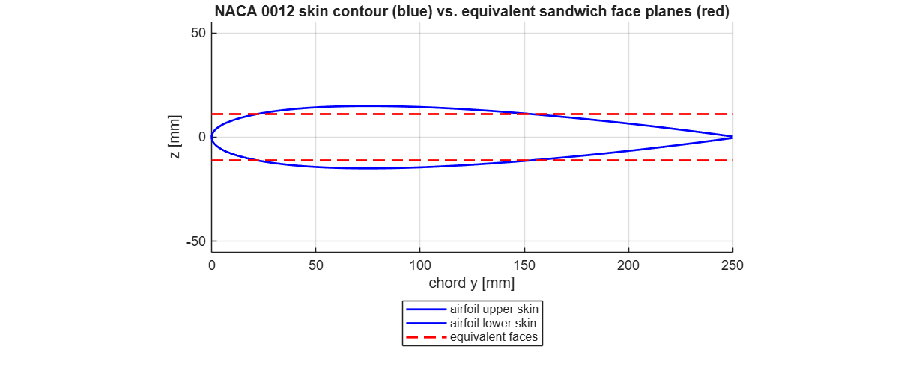
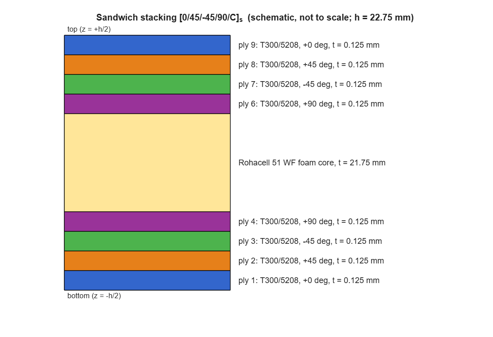
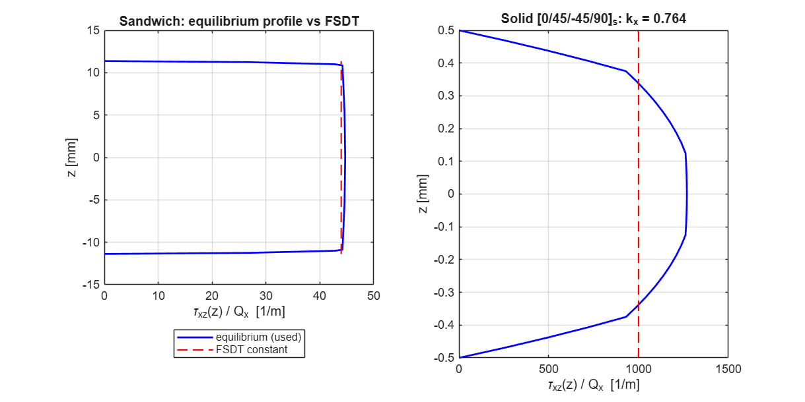
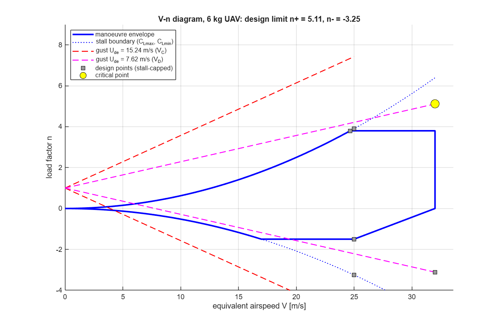
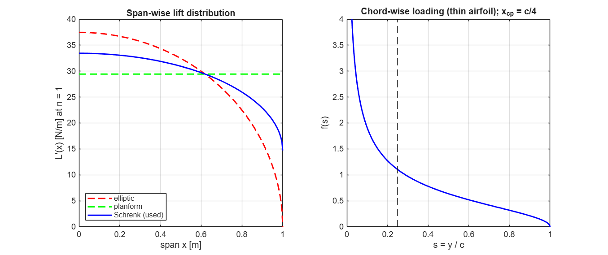
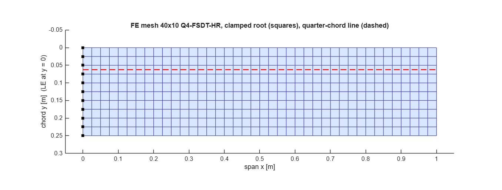

# Milestone 1 — Problem Definition & Wing Modelling (Step 1)

**Project:** Physics-Informed AI-Based Digital Twin for Structural Health Monitoring of Composite UAV Wings
**Workflow option:** B — in-house FSDT MATLAB solver → AI digital twin
**Deliverable of this step:** *"Geometry & Inputs Ready"* — every modelling decision fixed, justified and coded in `config/wing_baseline_config.m`
**Script that reproduces every number below:** `milestone1/run_milestone1.m` (log: `results/data/M1_summary.txt`)

---

## 1. Purpose of Step 1

The digital twin can only be as good as the physical model under it. Step 1 answers six questions:

1. **What structure** are we modelling? (geometry, idealisation)
2. **What is it made of?** (lamina and core properties)
3. **How is it built?** (stacking sequence → laminate stiffness)
4. **How is it supported?** (boundary conditions)
5. **What loads act on it?** (flight envelope → design load cases)
6. **How will it be discretised?** (finite-element model)

Every answer is stored in **one struct `cfg`**. The DOE of Milestone 3 then generates thousands of variants just by perturbing fields of `cfg`.

---

## 2. Coordinate system and idealisation

| Axis | Direction | Origin |
|---|---|---|
| **x** | span-wise, root → tip | wing root (fuselage side) |
| **y** | chord-wise, leading edge (LE) → trailing edge (TE) | leading edge |
| **z** | up (lift direction) | laminate mid-surface |

**Idealisation:** the semi-wing is a **cantilever sandwich plate**, clamped at the root (x = 0) and free on the other three edges.

| Assumption | Justification | Upgrade path (later) |
|---|---|---|
| Constant-thickness plate instead of a curved airfoil shell | Bending stiffness is matched to the real airfoil skins (Section 4). This is the standard "equivalent plate" wing idealisation used in aeroelasticity and SHM literature. | Variable-thickness elements follow the airfoil |
| Foam-core sandwich, no discrete spars | Typical construction of small composite UAV wings (foam core + carbon skins) | Add spar caps as stiffened element strips |
| Root perfectly clamped | Fuselage attachment is much stiffer than the wing | Root rotational springs (from tests) |
| Linear elastic, small deflection | Tip deflection < 1 % of span at limit load (Milestone 2) | Geometric non-linearity is not needed |
| Quasi-steady aerodynamics | Design gust is slow compared with the 1st mode (t_g/T₁ = 6) | Unsteady (Küssner/Wagner) aero for flutter |

---

## 3. Geometry

| Parameter | Symbol | Value |
|---|---|---|
| Semi-span | b | 1.000 m |
| Root chord | c_r | 0.250 m |
| Taper ratio | λ = c_t/c_r | 1.0 (rectangular) |
| Leading-edge sweep | Λ_LE | 0° |
| Airfoil | — | NACA 0012 (t/c = 0.12, t_max = 30 mm) |
| Full wing area | S | 0.500 m² |
| Aspect ratio | AR = (2b)²/S | 8.0 |

The mesh generator (`src/mesh/wing_mesh.m`) already supports taper and sweep through the map

$$x = \xi\,b,\qquad c(x) = c_r\,[1-(1-\lambda)\,\xi],\qquad y = x\tan\Lambda_{LE} + \eta\,c(x),\qquad (\xi,\eta)\in[0,1]^2 .$$

So geometry can become a DOE variable later without any code change.

---

## 4. Equivalent sandwich depth (from the real airfoil)

**Problem.** A plate has a constant thickness, but the airfoil does not. Which core thickness gives the *same bending stiffness* as skins wrapped around a NACA 0012?

**Theory.** The NACA 4-digit half-thickness is

$$y_t(s) = 5\,\tau\left(0.2969\sqrt{s}-0.1260\,s-0.3516\,s^2+0.2843\,s^3-0.1015\,s^4\right)c,\qquad s=x/c,\ \tau=t/c .$$

- Skins of thickness *t_f* following the contour have, about the chord line, a second moment of area
  $I_{airfoil} = 2\,t_f\int_0^c y_t^2\,dx$.
- A flat sandwich whose face centroids are a distance *d* apart has
  $I_{sandwich} = 2\,t_f\,c\,(d/2)^2$.
- Equating the two gives the **bending-equivalent depth**

$$\boxed{d_{eq} = 2\sqrt{\tfrac{1}{c}\int_0^c y_t^2\,dx}} .$$

**Result.** For NACA 0012, c = 250 mm: **d_eq = 22.26 mm**. The mean airfoil thickness is 20.55 mm and the maximum is 30 mm.
Chosen core: **t_c = 21.75 mm** + face 0.5 mm → **d = 22.25 mm (99.9 % of d_eq)**.



> **Why this matters.** If we had used the *maximum* thickness (30 mm), bending stiffness would be over-estimated by (30/22.3)² ≈ 1.8×. Frequencies would then be ~35 % too high, and every damage-sensitive feature the AI learns would be biased.

---

## 5. Materials — orthotropic elasticity

### 5.1 Generalised Hooke's law for one ply

A unidirectional ply is **orthotropic**: it has three planes of material symmetry. In the material axes (1 = fibre, 2 = transverse, 3 = thickness), the compliance form is

$$
\begin{Bmatrix}\varepsilon_1\\\varepsilon_2\\\varepsilon_3\\\gamma_{23}\\\gamma_{13}\\\gamma_{12}\end{Bmatrix}=
\begin{bmatrix}
\tfrac{1}{E_1}&-\tfrac{\nu_{21}}{E_2}&-\tfrac{\nu_{31}}{E_3}&0&0&0\\
-\tfrac{\nu_{12}}{E_1}&\tfrac{1}{E_2}&-\tfrac{\nu_{32}}{E_3}&0&0&0\\
-\tfrac{\nu_{13}}{E_1}&-\tfrac{\nu_{23}}{E_2}&\tfrac{1}{E_3}&0&0&0\\
0&0&0&\tfrac{1}{G_{23}}&0&0\\0&0&0&0&\tfrac{1}{G_{13}}&0\\0&0&0&0&0&\tfrac{1}{G_{12}}
\end{bmatrix}
\begin{Bmatrix}\sigma_1\\\sigma_2\\\sigma_3\\\tau_{23}\\\tau_{13}\\\tau_{12}\end{Bmatrix},
\qquad \frac{\nu_{12}}{E_1}=\frac{\nu_{21}}{E_2}\ \text{(Maxwell–Betti reciprocity)} .
$$

**Plane-stress reduction** (σ₃ = 0, valid for thin plies) gives the *reduced stiffness* used by all plate theories (`src/materials/ply_stiffness.m`):

$$
Q_{11}=\frac{E_1}{1-\nu_{12}\nu_{21}},\quad Q_{22}=\frac{E_2}{1-\nu_{12}\nu_{21}},\quad Q_{12}=\frac{\nu_{12}E_2}{1-\nu_{12}\nu_{21}},\quad Q_{66}=G_{12},\qquad Q_{44}=G_{23},\ Q_{55}=G_{13}.
$$

FSDT keeps the two **transverse shear** stiffnesses Q₄₄ and Q₅₅; classical theory throws them away. This is the whole reason for FSDT (Section 7).

### 5.2 Property database (`src/materials/material_library.m`)

| Property | T300/5208 (skins) | Rohacell 51 WF (core) | AS4/3501-6 (DOE) | E-glass/epoxy (DOE) |
|---|---|---|---|---|
| E₁ [GPa] | 181 | 0.075 | 147 | 38.6 |
| E₂ [GPa] | 10.3 | 0.075 | 10.3 | 8.27 |
| G₁₂ [GPa] | 7.17 | 0.024 | 7.0 | 4.14 |
| G₁₃ [GPa] | 7.17 | 0.024 | 7.0 | 4.14 |
| G₂₃ [GPa] | 3.46 | 0.024 | 3.7 | 2.95 |
| ν₁₂ | 0.28 | 0.30 | 0.27 | 0.26 |
| ρ [kg/m³] | 1600 | 52 | 1580 | 1800 |
| X_t / X_c [MPa] | 1500 / 1500 | 1.6 / 0.8 | 2280 / 1725 | 1062 / 610 |
| Y_t / Y_c [MPa] | 40 / 246 | — | 57 / 228 | 31 / 118 |
| S₁₂ [MPa] | 68 | 0.8 (shear) | 76 | 72 |

**G₂₃ of a transversely isotropic ply.** The 2–3 plane is isotropic, so G₂₃ = E₂ / [2(1+ν₂₃)]. With ν₂₃ ≈ 0.49 for carbon/epoxy, G₂₃ = 10.3/2.98 = **3.46 GPa**. This value comes from the theory, so it replaces the rounded 3.0 GPa I quoted in the planning stage.

**Foam core.** For PMI foam, E/(2G) − 1 = 0.56 > 0.5, so it cannot be a perfectly isotropic solid. It is therefore stored as an orthotropic layer with independent E = 75 MPa and G = 24 MPa (Rohacell WF datasheet).

---

## 6. Laminate — Classical Lamination Theory (CLT)

### 6.1 Ply rotation

A ply at angle θ to the x-axis (span) has transformed stiffness

$$\bar{\mathbf Q} = \mathbf T_\varepsilon^{\!T}\,\mathbf Q\,\mathbf T_\varepsilon,\qquad
\mathbf T_\varepsilon=\begin{bmatrix}c^2&s^2&cs\\s^2&c^2&-cs\\-2cs&2cs&c^2-s^2\end{bmatrix},\quad c=\cos\theta,\ s=\sin\theta,$$

using engineering shear strain. The form Tᵀ Q T follows from equal strain energy in both axis systems. The transverse shear stiffness rotates as a 2-D tensor:

$$\bar{\mathbf Q}_s = \mathbf R^T\mathbf Q_s\mathbf R,\qquad \mathbf R=\begin{bmatrix}c&s\\-s&c\end{bmatrix}.$$

### 6.2 Stacking sequence (chosen)

**[0/45/−45/90/CORE/90/−45/45/0]** — quasi-isotropic carbon faces on a foam core, symmetric about the mid-plane.



| Choice | Reason |
|---|---|
| 0° plies outermost | They carry span-wise bending most efficiently (largest z²) |
| ±45° pair | Torsional stiffness and in-plane shear; balanced, so A₁₆ = A₂₆ = 0 |
| 90° next to the core | Chord-wise stiffness; protects the core interface |
| Symmetric | B = 0, so no bending–extension coupling and no warping on cure |

### 6.3 Stiffness matrices

$$
\begin{Bmatrix}\mathbf N\\\mathbf M\end{Bmatrix}=\begin{bmatrix}\mathbf A&\mathbf B\\\mathbf B&\mathbf D\end{bmatrix}\begin{Bmatrix}\boldsymbol\varepsilon^0\\\boldsymbol\kappa\end{Bmatrix},\qquad
(\mathbf A,\mathbf B,\mathbf D)=\sum_{k=1}^{N}\bar{\mathbf Q}_k\left(z_k-z_{k-1},\ \tfrac{z_k^2-z_{k-1}^2}{2},\ \tfrac{z_k^3-z_{k-1}^3}{3}\right).
$$

**Computed values** (`src/materials/laminate_section.m`):

| Matrix | Value | Comment |
|---|---|---|
| A [MN/m] | A₁₁ = A₂₂ = 78.16, A₁₂ = 23.15, A₆₆ = 27.40, A₁₆ = 0 | Quasi-isotropic: A₆₆ = (A₁₁−A₁₂)/2 ✓ |
| B [N] | max \|Bᵢⱼ\| = 2·10⁻¹¹ (round-off) | Symmetric laminate ✓ |
| D [N·m] | D₁₁ = 9703, D₂₂ = 9345, D₁₂ = 2819, D₆₆ = 3348, D₁₆ = D₂₆ = 29.8 | D₁₁ > D₂₂ because the 0° plies are outermost |

**Cross-check with sandwich theory** (Allen, 1969): D ≈ E_f t_f d²/2 = 8623 N·m. CLT gives 9703 N·m. The 12 % difference is real: thin-face theory treats each face as one smeared layer, while CLT sees the 0° plies at the outer surface.

> **D₁₆, D₂₆ ≠ 0.** Even a "balanced" ±45 pair gives bending–twisting coupling, because the +45 and −45 plies sit at different z. The FE solver keeps the full D, so this coupling appears in the twist results of Milestone 2.

---

## 7. Transverse shear and the shear-correction factor

### 7.1 Why the textbook k = 5/6 is wrong for this wing

FSDT assumes a **constant** shear strain through the thickness. The real shear stress follows from 3-D equilibrium, ∂τ_xz/∂z = −∂σ_x/∂x. Integrating layer by layer gives

$$\tau_{xz}(z)=-\frac{Q_x}{D_x}\,g(z),\qquad g(z)=\int_{-h/2}^{z}E(\zeta)\,(\zeta-z_n)\,d\zeta,\qquad E=\bar Q_{11}(z),$$

where z_n is the neutral axis. Equating the shear strain energy of this exact distribution with the FSDT energy Q_x²/(2k∫G dz) gives the **energy-equivalent shear correction factor** (Whitney 1973; Vlachoutsis 1992):

$$\boxed{k_x = \frac{D_x^2}{\displaystyle\int_{-h/2}^{h/2}G(z)\,dz\ \int_{-h/2}^{h/2}\frac{g(z)^2}{G(z)}\,dz}},\qquad G=\bar Q_{55}.$$

`src/materials/shear_correction.m` evaluates this integral exactly. g² is quartic in each ply, so 3-point Gauss integration is exact.

| Laminate | k_x | k_y |
|---|---|---|
| Homogeneous plate | **0.8333 = 5/6** (proves the formula) | 0.8333 |
| Solid [0/45/−45/90]ₛ, 8 plies | 0.764 | 0.800 |
| **Our sandwich** | **0.0954** | **0.0919** |

### 7.2 Physical meaning



In a sandwich the stiff faces carry almost no shear: the shear stress is nearly constant **in the soft core** and drops to zero across the faces. The correct shear stiffness is therefore

$$S = \frac{G_c\,d^2}{t_c}\quad\text{(Allen 1969)} = 0.546\ \text{MN/m},$$

| Model | A_s,11 [MN/m] | Ratio to sandwich theory |
|---|---|---|
| FSDT, energy k (used) | 0.556 | **1.02** ✓ |
| FSDT, k = 5/6 | 4.86 | **8.9 ✗** |

> **Key insight for the project.** With k = 5/6 the model would make the core 9× stiffer in shear. A core debond or core crush is exactly a loss of core shear stiffness, so the AI would be trained on a structure that hides the very damage we want to detect. The energy-equivalent k is therefore a correctness requirement, not a refinement.

### 7.3 Mass properties

$$(I_0,I_1,I_2)=\sum_k\rho_k\left(z_k-z_{k-1},\ \tfrac{z_k^2-z_{k-1}^2}{2},\ \tfrac{z_k^3-z_{k-1}^3}{3}\right)$$

- I₀ = **2.731 kg/m²**.
- I₁ = 0 (symmetric).
- I₂ gives the rotary inertia, which FSDT keeps.

Semi-wing mass = **0.683 kg**. Both wings together are 22.8 % of MTOW, typical for a minimum-gauge small UAV.

---

## 8. Flight envelope (V–n diagram) and design load factors

### 8.1 Aircraft data

| m | W | W/S | C_Lmax / C_Lmin | V_C | V_D | n₊ / n₋ manoeuvre |
|---|---|---|---|---|---|---|
| 6 kg | 58.9 N | 117.7 N/m² | 1.2 / −1.0 | 25 m/s | 32 m/s (≥ 1.25 V_C) | +3.8 / −1.5 |

### 8.2 Theory

**Stall boundary:**

$$n_s(V)=\frac{\rho V^2 S\,C_{L\max}}{2W}\ \Rightarrow\ V_{S1}=\sqrt{\frac{2W}{\rho S C_{L\max}}}=12.66\ \text{m/s},\qquad V_A=V_{S1}\sqrt{n_+}=24.67\ \text{m/s}.$$

**Gust loads, Pratt–Walker formula (CS-23 style):**

$$a=\frac{2\pi AR}{2+\sqrt{AR^2+4}},\qquad \mu=\frac{2W/S}{\rho\,\bar c\,a\,g},\qquad K_g=\frac{0.88\mu}{5.3+\mu},\qquad \Delta n=\frac{\rho\,U_{de}\,V\,a\,K_g}{2W/S}.$$

| a | μ | K_g | Δn at V_C (U = 15.24 m/s) | Δn at V_D (U = 7.62 m/s) |
|---|---|---|---|---|
| 4.906 /rad | 15.97 | 0.661 | 6.43 | 4.11 |

**Stall cap:** the wing cannot produce more lift than C_Lmax at a given speed, so each gust point is limited to n ≤ n_s(V).

### 8.3 Result

| Design point | V [m/s] | n |
|---|---|---|
| Manoeuvre + | 24.7 | +3.80 |
| Manoeuvre − | 25.0 | −1.50 |
| Gust + at V_C (stall-capped from 7.43) | 25.0 | +3.90 |
| **Gust + at V_D** | **32.0** | **+5.11 ← critical** |
| Gust − at V_C | 25.0 | −3.25 |
| Gust − at V_D | 32.0 | −3.11 |



> **Engineering finding.** Light UAVs have low wing loading, so they are **gust-critical, not manoeuvre-critical**: the design limit factor 5.11 exceeds the manoeuvre limit 3.8 by 34 %. A model built only on the manoeuvre limit would be un-conservative.

---

## 9. Aerodynamic load model and load cases

### 9.1 Span-wise lift — Schrenk's method (NACA TM-948)

$$L'_e(x)=\frac{4L}{\pi b}\sqrt{1-(x/b)^2},\qquad L'_p(x)=\frac{L\,c(x)}{S_{semi}},\qquad L'(x)=\tfrac12\left[L'_e(x)+L'_p(x)\right].$$

### 9.2 Chord-wise lift — thin-airfoil theory

For a thin airfoil at incidence, the pressure difference is

$$f(s)=\frac{2}{\pi}\sqrt{\frac{1-s}{s}},\qquad \int_0^1 f\,ds=1,\qquad \int_0^1 s\,f\,ds=\tfrac14 .$$

- The centre of pressure is exactly at the **quarter chord** (the aerodynamic centre). It lies ahead of the plate's elastic axis at mid-chord, so lift also **twists the wing nose-up**. This is the physical seed of divergence, and it gives the AI a torsional signal to learn from.
- Pressure field: p(x,y) = L'(x) f(s) / c(x).



### 9.3 Numerical detail: the leading-edge singularity

f(s) ~ s^(−1/2) is integrable but singular at the LE, so ordinary Gauss quadrature converges slowly:

| Gauss points | Total lift recovered | Centre-of-pressure arm (exact 0.0625 m) |
|---|---|---|
| 6 × 6 (plain) | 97.3 % | 0.0608 m |
| 24 × 24 (plain) | 99.3 % | 0.0621 m |

**Remedy** (`src/loads/pressure_load.m`): in LE elements, use the substitution η = −1 + 2t², dη = 4t dt. The 1/√s singularity is cancelled by the Jacobian. With only 4 points the result is **100.003 % of the lift and an arm of 0.062496 m (exact to 10⁻⁵)**.

### 9.4 Inertia relief

At load factor n, the wing's own mass pushes down while lift pushes up:

$$\mathbf F = n\,\frac{W}{2}\,\hat{\mathbf F}_{lift}\;-\;n\,g\,\mathbf M\,\mathbf r_z ,$$

where M is the consistent mass matrix and r_z the unit vertical rigid-body vector. For LC1 this reduces the root bending moment by about 25 % (13.6 → 10.25 N·m).

### 9.5 Design load cases (`src/loads/wing_load_cases.m`)

| Case | n | Net F_z [N] | Root bending M_x [N·m] | Torque about mid-chord [N·m] |
|---|---|---|---|---|
| LC1 cruise 1 g | 1.00 | 22.73 | 10.25 | 1.84 |
| LC2 manoeuvre + | 3.80 | 86.38 | 38.97 | 6.99 |
| LC3 manoeuvre − | −1.50 | −34.10 | −15.38 | −2.76 |
| **LC4 critical gust** | **5.11** | **116.22** | **52.42** | **9.40** |
| LC5 ultimate (1.5 × LC4) | 7.67 | 174.33 | 78.64 | 14.11 |
| LC6 ground tip test (50 N, mid-chord) | — | 50.00 | 50.00 | 0.00 |

LC6 is a **laboratory validation case**: it is what you would apply on a test rig to compare against strain gauges (Milestone 6).

---

## 10. Boundary conditions and finite-element model

- **BC:** clamped root, u = v = w = ψₓ = ψᵧ = 0 at x = 0.
- **Mesh:** 40 × 10 four-node FSDT elements (25 × 25 mm), 451 nodes, **2255 DOF** (2200 free). Milestone 2 shows this mesh is within 0.08 % (deflection) and 0.32 % (first six frequencies) of the converged solution.



---

## 11. Summary of decisions and changes from the planning defaults

| Item | Planning default | Final | Why |
|---|---|---|---|
| Laminate | 8-ply [0/45/−45/90]ₛ solid, 1 mm | **Sandwich [0/45/−45/90/C]ₛ, 22.75 mm** | A 1 mm solid plate of 1 m span would deflect ~2 m under 1 g, which is physically impossible. The sandwich matches the real airfoil's skin bending stiffness. |
| G₂₃ (T300) | 3.0 GPa | 3.46 GPa | Derived from transverse isotropy, ν₂₃ = 0.49 |
| Shear correction | k = 5/6 | Energy-equivalent (0.095 / 0.092) | k = 5/6 is 9× wrong for sandwiches |
| Limit load factor | 3.8 | **5.11** | Gust-critical aircraft |
| Material, geometry, loads | as planned | as planned | — |

---

## 12. How to verify in MATLAB

```matlab
>> cd uav_shm_dt
>> setup_paths
>> run_milestone1          % ~5 s
```

You should see these numbers:

| Check | Expected |
|---|---|
| d_eq | 22.26 mm |
| I₀ | 2.731 kg/m² |
| A₁₁, D₁₁ | 78.1608 MN/m, 9703.16 N·m |
| k_x, k_y | 0.0954, 0.0919 |
| As₁₁ (energy k) vs Allen | 0.5564 vs 0.5463 MN/m |
| V_S1, V_A | 12.66, 24.67 m/s |
| Design n₊ | 5.11 (gust at V_D) |
| LC4 root moment | 52.424 N·m |
| Semi-wing mass | 0.6828 kg |

Six figures are written to `results/figures/M1_*.png`.

---

## 13. References

1. Reddy, J.N., *Mechanics of Laminated Composite Plates and Shells*, 2nd ed., CRC Press, 2004.
2. Jones, R.M., *Mechanics of Composite Materials*, 2nd ed., Taylor & Francis, 1999.
3. Tsai, S.W., Hahn, H.T., *Introduction to Composite Materials*, Technomic, 1980.
4. Daniel, I.M., Ishai, O., *Engineering Mechanics of Composite Materials*, Oxford, 2006.
5. Allen, H.G., *Analysis and Design of Structural Sandwich Panels*, Pergamon, 1969.
6. Whitney, J.M., "Shear correction factors for orthotropic laminates under static load," *J. Appl. Mech.* 40, 1973.
7. Vlachoutsis, S., "Shear correction factors for plates and shells," *Int. J. Numer. Meth. Eng.* 33, 1992.
8. Schrenk, O., "A simple approximation method for obtaining the spanwise lift distribution," NACA TM-948, 1940.
9. Anderson, J.D., *Fundamentals of Aerodynamics* (thin-airfoil theory), McGraw-Hill.
10. EASA CS-23 / CS-VLA (manoeuvre and gust load requirements); Pratt, K.G., Walker, W.G., NACA Report 1206, 1954.
11. Abbott, I.H., von Doenhoff, A.E., *Theory of Wing Sections* (NACA 4-digit equation), Dover.
