# Milestone 2 — In-house FSDT Solver: Theory, Implementation, Verification & Wing Results (Step 2)

**Deliverable of this step:** *"Validated FSDT MATLAB Solver"*
**Scripts:**

- `validation/run_all_validation.m`: 9 benchmark groups, **42/42 required checks pass**.
- `milestone2/run_milestone2.m`: wing analyses (static, modal, dynamic, damage).

**Logs:** `results/data/validation_summary.txt`, `results/data/M2_summary.txt`

---

## 1. Why an in-house FSDT solver?

| Need of the digital twin | What the solver gives |
|---|---|
| Thousands of DOE runs (Milestone 3) | ~0.25 s per complete static + modal analysis, scriptable, no licence |
| Physics residuals for the PINN loss (Milestone 5) | We own every equation: K, M, the B-operators and the shear stiffness As can be exported |
| Damage of any shape | Element-wise section properties (continuum damage) |
| Correct sandwich physics | Energy-equivalent shear correction + transverse-shear stress recovery |
| Real-time surrogate (Milestone 6) | The same K, M feed reduced-order models and Kalman filters |

---

## 2. First-order Shear Deformation Theory (Reissner–Mindlin)

### 2.1 Kinematics

$$u(x,y,z,t)=u_0+z\,\psi_x,\qquad v(x,y,z,t)=v_0+z\,\psi_y,\qquad w(x,y,z,t)=w_0 .$$

There are five unknown fields: u₀, v₀, w₀, ψₓ, ψᵧ.

- **CLT/Kirchhoff** forces ψₓ = −∂w/∂x, which means the normal stays perpendicular and the shear strain is zero.
- **FSDT** lets the normal rotate independently, so transverse shear strain exists.

### 2.2 Strains

$$
\boldsymbol\varepsilon=\boldsymbol\varepsilon^0+z\boldsymbol\kappa:\quad
\boldsymbol\varepsilon^0=\begin{Bmatrix}u_{0,x}\\v_{0,y}\\u_{0,y}+v_{0,x}\end{Bmatrix},\
\boldsymbol\kappa=\begin{Bmatrix}\psi_{x,x}\\\psi_{y,y}\\\psi_{x,y}+\psi_{y,x}\end{Bmatrix},\qquad
\boldsymbol\gamma=\begin{Bmatrix}\gamma_{xz}\\\gamma_{yz}\end{Bmatrix}=\begin{Bmatrix}w_{0,x}+\psi_x\\w_{0,y}+\psi_y\end{Bmatrix}.
$$

### 2.3 Stress resultants and constitutive law

$$(\mathbf N,\mathbf M)=\int_{-h/2}^{h/2}\boldsymbol\sigma\,(1,z)\,dz,\qquad \mathbf Q=\int\boldsymbol\tau\,dz$$

$$\begin{Bmatrix}\mathbf N\\\mathbf M\end{Bmatrix}=\begin{bmatrix}\mathbf A&\mathbf B\\\mathbf B&\mathbf D\end{bmatrix}\begin{Bmatrix}\boldsymbol\varepsilon^0\\\boldsymbol\kappa\end{Bmatrix},\qquad \mathbf Q=\mathbf A_s\boldsymbol\gamma,\quad A_{s,ij}=k_{ij}\sum_k\bar Q_{s,ij}^{(k)}(z_k-z_{k-1})$$

The shear correction factors k come from the energy method of Milestone 1.

### 2.4 Governing equations (Hamilton's principle)

$$\delta\int_{t_1}^{t_2}(T-U+W)\,dt=0$$

This gives the five FSDT equations of motion:

$$
\begin{aligned}
N_{x,x}+N_{xy,y}&=I_0\ddot u_0+I_1\ddot\psi_x, &
N_{xy,x}+N_{y,y}&=I_0\ddot v_0+I_1\ddot\psi_y,\\
Q_{x,x}+Q_{y,y}+q&=I_0\ddot w_0, &&\\
M_{x,x}+M_{xy,y}-Q_x&=I_1\ddot u_0+I_2\ddot\psi_x, &
M_{xy,x}+M_{y,y}-Q_y&=I_1\ddot v_0+I_2\ddot\psi_y .
\end{aligned}
$$

**These five equations are the physics the PINN will enforce in Milestone 5.**

### 2.5 Weak form (principle of virtual work)

$$\int_A\left(\delta\boldsymbol\varepsilon^{0T}\mathbf N+\delta\boldsymbol\kappa^T\mathbf M+\delta\boldsymbol\gamma^T\mathbf Q\right)dA+\int_A\delta\mathbf u^T\mathbf m\,\ddot{\mathbf u}\,dA=\int_A\delta w\,q\,dA,$$

$$\mathbf m=\begin{bmatrix}I_0&0&0&I_1&0\\0&I_0&0&0&I_1\\0&0&I_0&0&0\\I_1&0&0&I_2&0\\0&I_1&0&0&I_2\end{bmatrix}.$$

---

## 3. Finite-element discretisation

### 3.1 Element

- 4-node isoparametric quadrilateral (`src/element/elem_fsdt_q4.m`).
- 5 DOF per node, [u v w ψₓ ψᵧ], so **20 DOF per element**.
- Bilinear shape functions $N_a=\tfrac14(1+\xi_a\xi)(1+\eta_a\eta)$.
- Jacobian $\mathbf J=\begin{bmatrix}x_{,\xi}&y_{,\xi}\\x_{,\eta}&y_{,\eta}\end{bmatrix}$ and $\partial N/\partial(x,y)=\mathbf J^{-1}\partial N/\partial(\xi,\eta)$.

Generalised strains are written ε⁰ = B_m d, κ = B_b d, γ = B_s d, so that

$$\mathbf K_e=\int_{A_e}\begin{bmatrix}\mathbf B_m\\\mathbf B_b\end{bmatrix}^T\begin{bmatrix}\mathbf A&\mathbf B\\\mathbf B&\mathbf D\end{bmatrix}\begin{bmatrix}\mathbf B_m\\\mathbf B_b\end{bmatrix}dA+\mathbf K_s,\qquad
\mathbf M_e=\int_{A_e}\mathbf N^T\mathbf m\,\mathbf N\,dA\ \text{(consistent, incl. rotary inertia)}$$

Both are integrated with 2 × 2 Gauss quadrature, which is exact for parallelograms.

### 3.2 The central difficulty: shear locking

As h → 0, FSDT must recover Kirchhoff theory, which requires γ = w,ₓ + ψₓ → 0.

- With bilinear w and ψ, the constraint w,ₓ + ψₓ = 0 at every Gauss point is too strong.
- The element can then only satisfy it by not bending at all. It **locks**: deflection goes to zero.

**Validation V05:** the fully integrated element gives 15 % of the correct deflection at a/h = 100 and 0.002 % at a/h = 10⁴.

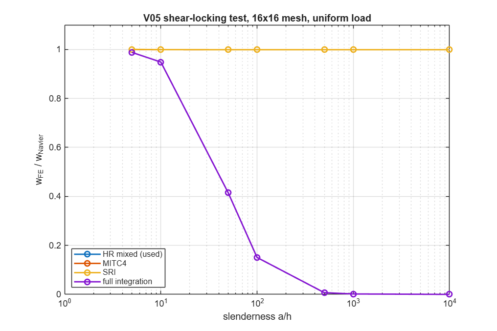

| Remedy | Locking-free | Rigid-body modes | Distorted patch test | Comment |
|---|---|---|---|---|
| Full integration | ✗ | 6 | — | reference only |
| Selective reduced integration (1-pt shear) | ✓ | **8 (2 spurious hourglass modes)** | — | dangerous with weak supports |
| MITC4 (assumed strain) | ✓ | 6 | ✓ | Bathe–Dvorkin 1985 |
| **Hellinger–Reissner mixed (used)** | ✓ | **6** | **✓ (1.8·10⁻¹¹)** | gives shear forces directly |

### 3.3 Hellinger–Reissner (HR) mixed formulation — derivation

The HR principle treats **displacements and stresses as independent fields**. For the transverse-shear part:

$$\Pi_{HR}(\mathbf u,\mathbf Q)=\int_A\left(\mathbf Q^T\bar{\boldsymbol\gamma}(\mathbf u)-\tfrac12\mathbf Q^T\mathbf A_s^{-1}\mathbf Q\right)dA .$$

- Stationarity with respect to Q gives the constitutive law **weakly**: ∫ δQᵀ(γ̄ − A_s⁻¹Q) dA = 0.
- Stationarity with respect to u gives equilibrium.

**Ingredient 1 — assumed covariant shear strain (tying).** On each element edge, the displacement-based covariant strain at the edge **mid-point** is exact for any quadratic w and linear ψ. The strain field is therefore built by interpolating between those four points (A, C on the η = ∓1 edges; D, B on the ξ = ∓1 edges):

$$\bar\gamma_\xi=\tfrac{1-\eta}2\gamma_\xi^A+\tfrac{1+\eta}2\gamma_\xi^C,\qquad \bar\gamma_\eta=\tfrac{1-\xi}2\gamma_\eta^D+\tfrac{1+\xi}2\gamma_\eta^B,\qquad \gamma_\xi=x_{,\xi}\gamma_{xz}+y_{,\xi}\gamma_{yz}.$$

**Ingredient 2 — assumed shear-force field, Piola-mapped.**

$$\hat{\mathbf Q}=\begin{bmatrix}1&\eta&0&0\\0&0&1&\xi\end{bmatrix}\boldsymbol\beta=\hat{\mathbf P}\boldsymbol\beta,\qquad \mathbf Q=\frac{\mathbf J^T\hat{\mathbf Q}}{\det\mathbf J}=\mathbf P\boldsymbol\beta .$$

The Piola map makes the coupling term exact in the parent square: $\mathbf Q^T\bar{\boldsymbol\gamma}\,dA=\hat{\mathbf Q}^T\bar{\boldsymbol\gamma}_{cov}\,d\xi\,d\eta$.

**Element condensation.** Substituting the two fields:

$$\Pi_e=\boldsymbol\beta^T\mathbf G\,\mathbf d-\tfrac12\boldsymbol\beta^T\mathbf H\boldsymbol\beta,\qquad
\mathbf H=\int_{A_e}\mathbf P^T\mathbf A_s^{-1}\mathbf P\,dA,\qquad \mathbf G=\int_{-1}^{1}\!\!\int_{-1}^{1}\hat{\mathbf P}^T\bar{\mathbf B}_{cov}\,d\xi\,d\eta$$

Setting ∂Π_e/∂β = 0 gives β = H⁻¹G d. Then

$$\boxed{\mathbf K_s=\mathbf G^T\mathbf H^{-1}\mathbf G},\qquad \mathbf Q_{centre}=\mathbf P(0,0)\,\mathbf H^{-1}\mathbf G\,\mathbf d .$$

**Properties, all verified numerically:**

- Exactly 6 zero-energy modes (V01).
- Passes the MacNeal–Harder distorted patch test for constant membrane strain and constant curvature, at a/h = 12 and 240, with interior error ≤ 1.8·10⁻¹¹ (V02).
- No locking from a/h = 5 to 10⁴ (V05).
- Q is obtained from β with no differentiation of displacements, which is more accurate for the interlaminar stress recovery.

> **Note on history.** The first implementation mapped the assumed field with the centre Jacobian and used raw displacement strains. It was locking-free and correct on rectangles, but it **failed the distorted patch test (8–14 % error)**. Adding the tied covariant strains (ingredient 1) and the Piola map (ingredient 2) fixed it. This is why patch tests are part of the suite.

### 3.4 Assembly and boundary conditions

- **Sparse triplet assembly** (`src/assembly/assemble_system.m`). An element-matrix cache keyed by (section, shape) means a uniform 400-element wing computes **one** element matrix. This matters for the DOE.
- **Dirichlet BCs** are applied by partitioning into free and fixed DOFs (`apply_bc.m`):
  - clamped root (wing);
  - SS-1 simply supported for the Navier benchmarks: x = 0, a: v = w = ψᵧ = 0; y = 0, b: u = w = ψₓ = 0.

### 3.5 Solvers

| Analysis | Equation | Implementation |
|---|---|---|
| Static | K_ff d_f = F_f | sparse direct; reactions R = Kd − F |
| Modal | (K − ω²M)φ = 0 | `eig` (≤ 1500 DOF) or shift-invert `eigs`; mass-normalised φᵀMφ = 1; **sign fixed** (largest w positive) so ML features are deterministic |
| Transient | M d̈ + C ḋ + K d = F(t) | **Newmark-β**, γ = ½, β = ¼ (average acceleration): unconditionally stable, 2nd-order accurate, no numerical damping; K_eff factorised once with sparse Cholesky |
| Damping | C = αM + βK | Rayleigh, ζ(ω) = α/2ω + βω/2, fitted to ζ = 2 % at modes 1 and 5 |

Newmark update, with a₀ = 1/(βΔt²), a₁ = γ/(βΔt), …:

$$(\mathbf K+a_0\mathbf M+a_1\mathbf C)\,\mathbf d_{n+1}=\mathbf F_{n+1}+\mathbf M(a_0\mathbf d_n+a_2\dot{\mathbf d}_n+a_3\ddot{\mathbf d}_n)+\mathbf C(a_1\mathbf d_n+a_4\dot{\mathbf d}_n+a_5\ddot{\mathbf d}_n)$$

### 3.6 Stress recovery and failure (`src/post/recover_stresses.m`)

1. **In-plane ply stresses** at the bottom and top of each ply:
   σ_xy = Q̄_k(ε⁰ + zκ), then rotated to material axes, σ₁₂ = Q_k T_ε ε.
2. **Transverse shear through the thickness** from the equilibrium profile of Milestone 1:
   τ_xz(z) = Q_x f_x(z), with ∫f dz = 1.
   - FSDT alone gives a constant, physically wrong τ.
   - The profile gives correct **interlaminar shear at ply interfaces**, the delamination driver, and correct **core shear**, the debond driver.
3. **Failure indices**, all scaled so that 1 = failure:

| Criterion | Formula | Use |
|---|---|---|
| Tsai–Wu (as 1/R) | F₁σ₁+F₂σ₂+F₁₁σ₁²+F₂₂σ₂²+F₆₆τ²+2F₁₂σ₁σ₂ = 1 solved for the load multiplier R; F₁₂ = −½√(F₁₁F₂₂) | interactive ply failure |
| Hashin (1980) | fibre tension/compression, matrix tension/compression | identifies the failure **mode** (a damage label for the AI) |
| Max stress | max(σ₁/X, σ₂/Y, τ/S) | sanity check |
| Core shear | max τ_core / S_core | core shear failure |
| Interlaminar | ‖τ_interface‖ / S₂₃ | delamination onset |

### 3.7 Damage model (`src/damage/apply_damage.m`)

**Continuum damage mechanics:** property → (1 − D) · property inside an elliptical zone, with a uniform or Gaussian profile. Damaged elements get their own section, quantised into 20 severity levels so they can share cached element matrices.

| Type | Degraded properties | Physical mechanism |
|---|---|---|
| `skin_matrix` | E₂, G₁₂, G₂₃ of face plies | matrix micro-cracking |
| `skin_fiber` | E₁, E₂, G₁₂ of face plies | fibre breakage (impact) |
| `debond` | core G₁₃, G₂₃ | face/core disbond, loss of shear transfer |
| `core_crush` | all core moduli | impact core crushing |
| `delam` | G₁₃, G₂₃ at the mid-face interface | inter-ply delamination (equivalent single layer) |

### 3.8 Analytical reference — Navier solution (`src/analytical/navier_fsdt.m`)

For SS-1 cross-ply plates, the double-Fourier series

$$u=U\cos\alpha x\sin\beta y,\ v=V\sin\alpha x\cos\beta y,\ w=W\sin\alpha x\sin\beta y,\ \psi_x=X\cos\alpha x\sin\beta y,\ \psi_y=Y\sin\alpha x\cos\beta y,$$

with α = mπ/a and β = nπ/b, satisfies every boundary condition exactly. Substituting into the five equations of Section 2.4 gives a 5 × 5 algebraic system per (m, n):

$$([\mathbf S]-\omega^2[\mathbf M_m])\{U\,V\,W\,X\,Y\}^T=\{0\ 0\ Q_{mn}\ 0\ 0\}^T,$$

- S₃₃ = A₅₅α² + A₄₄β², S₄₄ = D₁₁α² + D₆₆β² + A₅₅, …; the full list is in the code header.
- Load coefficients: Q_mn = 16q₀/(π²mn) for a uniform load, q₀ for a sinusoidal load.

This gives an **exact** FSDT reference for the FE solver.

---

## 4. Verification & validation — all required checks passed (42 original + V10, V11)

Run: `setup_paths; run_all_validation` (about 30 s).

| # | Benchmark | What it proves | Result |
|---|---|---|---|
| V01 | Single distorted element eigenvalues | no spurious mechanisms | HR: 6 zero modes ✓ (SRI: 8 ✗) |
| V02 | MacNeal–Harder patch test, thin and thick | consistency → convergence | error ≤ 1.8·10⁻¹¹ ✓ |
| V03 | [0/90/90/0] SS plate, sinusoidal load, a/h = 4…100 | laminate + shear + stresses | w̄ within 0.13 %, σ̄ₓ within 0.3 % of Navier; **Navier = Reddy (2004) to 5 digits** (0.6627, 1.7100, 0.4912, 0.4337); convergence rate 1.99 (theory: 2) |
| V04 | Free vibration, [0/90/90/0] and **unsymmetric [0/90]** | mass matrix, rotary inertia, B-coupling | first 6 flexural ω̄ within 0.76 % |
| V05 | Shear-locking sweep, a/h = 5…10⁴ | locking-free | HR ≥ 0.9987 of exact at every a/h ✓ |
| V06 | Cantilever square plate (Leissa 1969) | clamped–free BCs, as on the wing | λ₁…₅ within 0.6 % |
| V07 | Cantilever strip vs Timoshenko beam, L/h = 5 and 100 | shear deflection | error 0.015 % |
| V08 | k = 5/6 recovery; sandwich vs Allen theory | shear correction | k exact to 10⁻¹⁶; sandwich within 0.2 % (k = 5/6 would be 29 % off) |
| V09 | Newmark: energy, step response, DAF | transient solver | energy drift 2·10⁻¹²; error vs exact modal solution 0.57 %; DAF 1.979 (theory 2) |
| V10 | **Wing modes vs independent 1-D theories** (added in review) | correctness of the wing mode shapes | bending 1B–5B within 0.5–0.9 % of a Timoshenko beam, **MAC = 1.0000**; 1T within 0.08 % of Reissner strip torsion, MAC = 1.0000 |
| V11 | 8-mode exact modal superposition vs full Newmark (added for Milestone 3) | fast solver used for every DOE sample | deflection 0.03 %, acceleration 0.04 % |

The full table with every value, reference, relative error and tolerance is in `results/data/validation_table.md`.

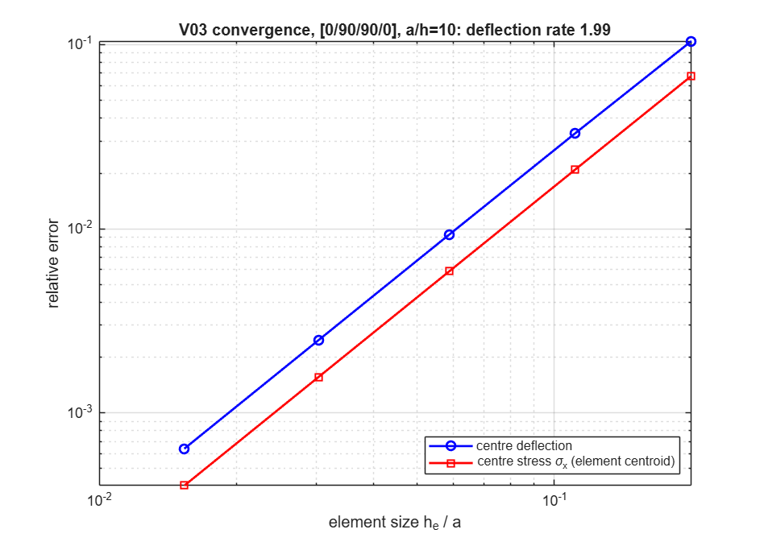
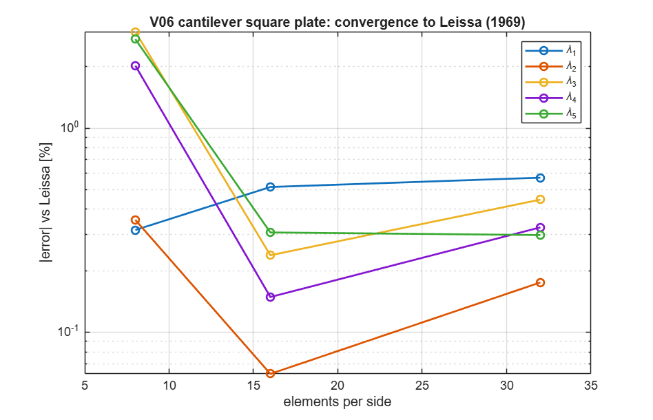
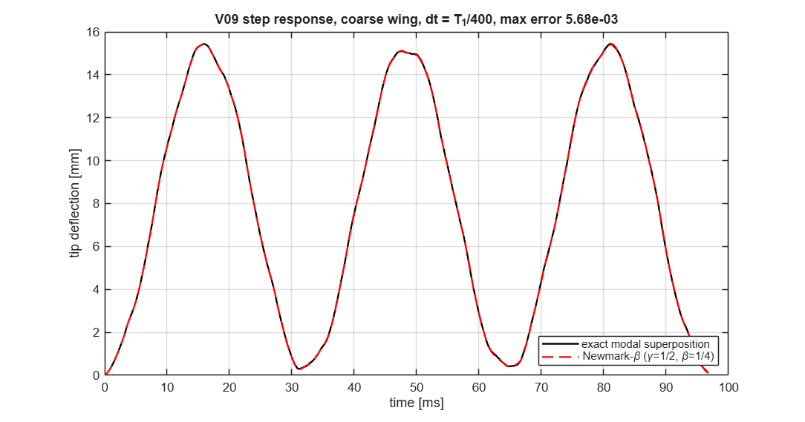

**Two benchmark lessons worth writing in the thesis:**

- **V04 in-plane modes.** The FE spectrum contains in-plane shear modes (m = 0, ω̄ = π√(G₁₂/E₂)·a/h ≈ 24.3) that the flexural Navier series excludes. They must be filtered out by their kinetic-energy share before the comparison.
- **V03 stress location.** For stresses compare at element centroids: use an odd mesh so a centroid sits at the plate centre. For deflection, use an even mesh so a node sits there.

---

## 5. Results for the baseline UAV wing

### 5.1 Mesh convergence (Richardson extrapolation)

Meshes 8×2 → 64×16 with a constant element aspect ratio and refinement ratio 2:

$$p=\frac{\ln\!\big[(q_2-q_1)/(q_3-q_2)\big]}{\ln 2},\qquad q_\infty=q_3+\frac{q_3-q_2}{2^p-1}.$$

| Quantity | Observed order p | Converged value | **Baseline 40×10 error** |
|---|---|---|---|
| Tip deflection, LC4 | 1.11 | 5.897 mm | 0.08 % |
| f₁ … f₆ | 1.46 – 1.99 | 30.92, 156.9, 162.5, 197.5, 377.8, 457.6 Hz | 0.05 – 0.32 % |
| Tsai–Wu at x = 50 mm | — | 0.0592 – 0.0595 on all meshes | < 0.5 % spread |
| **Peak Tsai–Wu (root TE corner)** | **−0.51 (diverges)** | — | — |

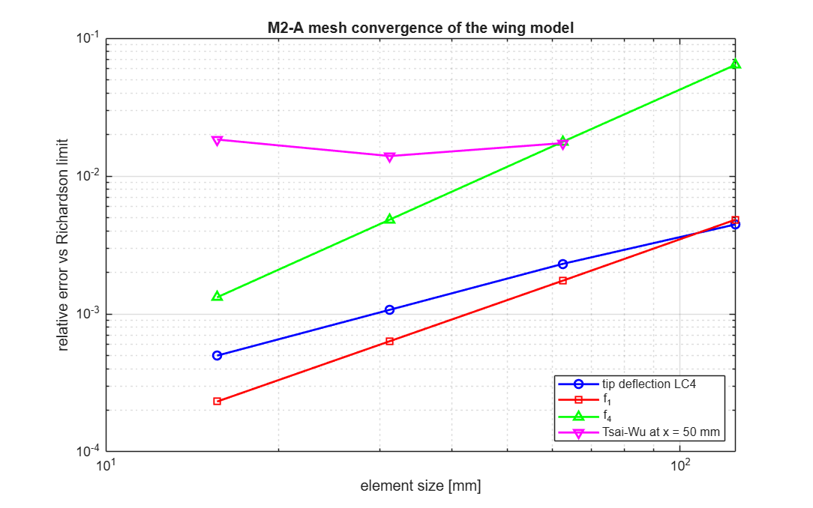

> **Stress singularity at the clamped corner.** Where a clamped edge meets a free edge, plate theory predicts stresses that grow without bound as r → 0 (Williams-type corner singularity). The peak Tsai–Wu therefore *keeps growing with refinement*: 0.057 → 0.062 → 0.069 → 0.079. This is physics, not a bug. Design values are read at **x = 50 mm (≈ 2h from the root)**, where they converge. In the real aircraft, the root fitting spreads this load.

### 5.2 Static analysis — all load cases (40×10 mesh, 2255 DOF)

| Case | n | w_LE [mm] | w_mid [mm] | w_TE [mm] | Tip twist [°] | ε_x max [µε] | Tsai–Wu | Hashin | Core shear | ILSS |
|---|---|---|---|---|---|---|---|---|---|---|
| LC1 cruise | 1.00 | 1.227 | 1.153 | 1.078 | +0.034 | 55 | 0.014 | 0.014 | 0.008 | 0.008 |
| LC2 manoeuvre + | 3.80 | 4.664 | 4.380 | 4.098 | +0.130 | 209 | 0.054 | 0.052 | 0.032 | 0.032 |
| LC3 manoeuvre − | −1.50 | −1.841 | −1.729 | −1.618 | −0.051 | 82 | 0.021 | 0.020 | 0.013 | 0.012 |
| **LC4 critical gust** | **5.11** | **6.275** | **5.892** | **5.513** | **+0.175** | **281** | 0.072 | 0.069 | 0.043 | 0.042 |
| LC5 ultimate | 7.67 | 9.413 | 8.839 | 8.270 | +0.262 | 421 | 0.108 | 0.104 | 0.064 | 0.064 |
| LC6 tip test 50 N | — | 7.789 | 7.896 | 7.780 | +0.002 | 265 | 0.067 | 0.065 | 0.062 | 0.061 |

- **Global equilibrium:** |ΣR_z + ΣF_z| / |ΣF_z| = 1.5·10⁻¹².
- **Nose-up twist:** the LE deflects more than the TE because lift acts at c/4, ahead of the elastic axis. This confirms the physics of Milestone 1, Section 9.2.
- **Ultimate strength (LC5):**

| Check | Index | Reserve factor RF |
|---|---|---|
| Tsai–Wu peak (ply 4, 90°, root TE corner) | 0.108 | 9.3 |
| Tsai–Wu converged design value (x = 50 mm) | 0.089 | **11.2** |
| Hashin peak — matrix tension | 0.104 | 9.6 |
| Core shear | 0.064 | 15.6 |
| Interlaminar shear | 0.064 | 15.8 |

The wing is **stiffness / minimum-gauge driven**, not strength driven. That is typical for small UAVs, and it is good news for SHM: damage first shows up as a change in *stiffness* (frequencies, strains) long before it threatens *strength*.

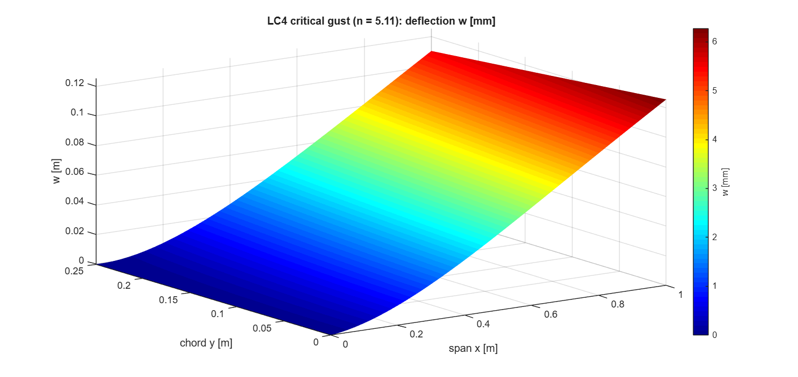
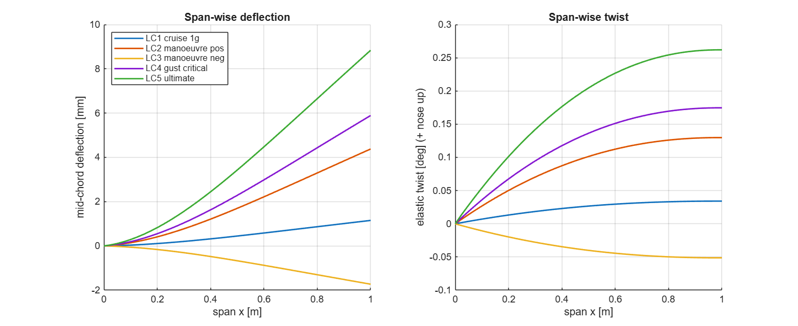
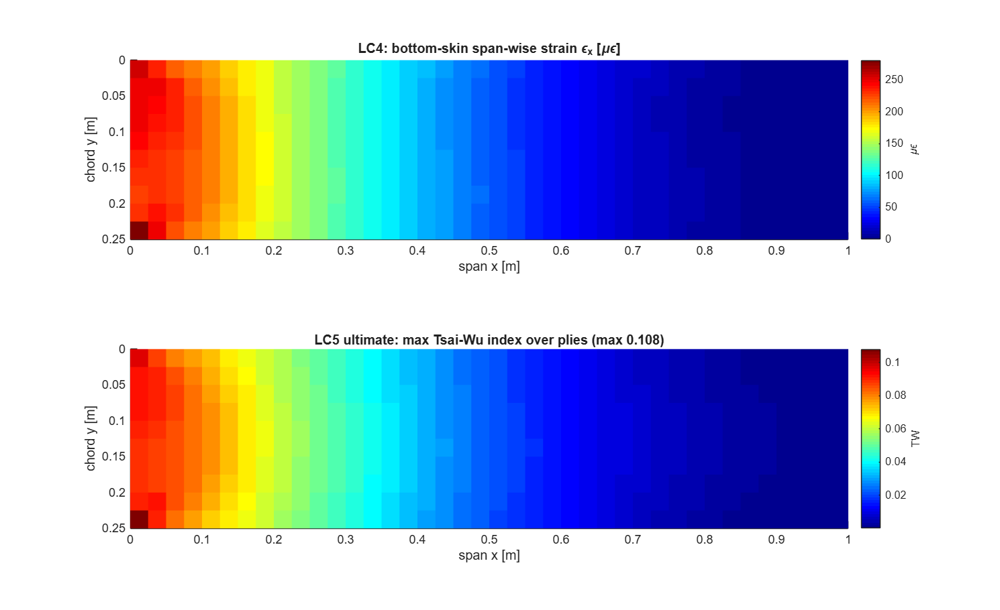
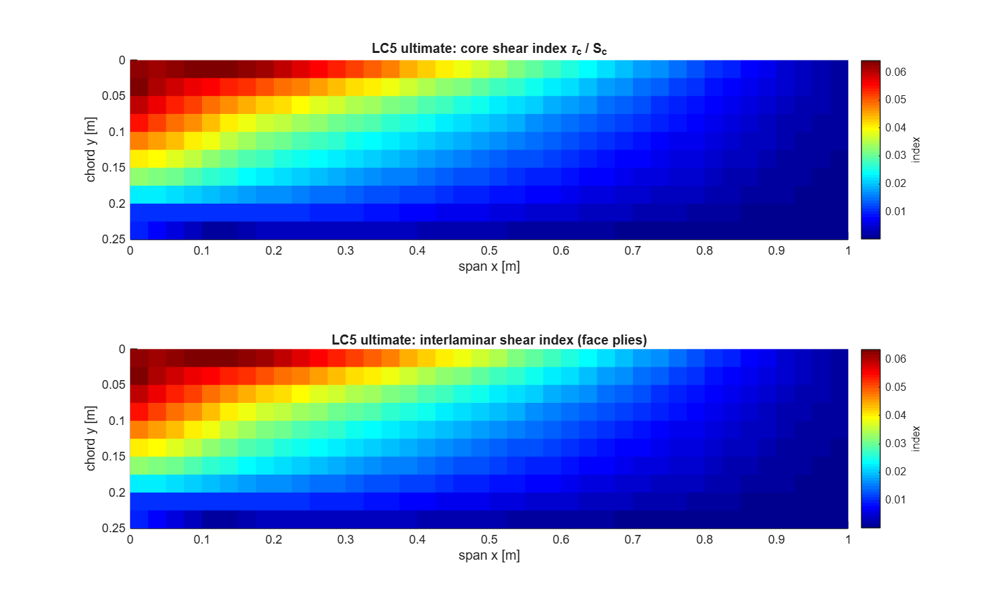

### 5.3 How much does transverse shear matter for this wing?

| Model | Tip deflection, LC4 | f₁ |
|---|---|---|
| **FSDT, energy k (used)** | 5.892 mm (100 %) | 30.93 Hz (100 %) |
| FSDT, k = 5/6 | 5.529 mm (93.8 %) | 32.03 Hz (103.5 %) |
| Shear-rigid (≈ CLT) | 5.424 mm (92.1 %) | 32.35 Hz (104.6 %) |

- Core shear contributes **8 % of the deflection** and **4.6 % of f₁**.
- The damage-induced frequency shifts of Section 5.6 are 0.1 – 1.4 %. A CLT model's error on f₁ (4.6 %) would be 3 to more than 100 times larger than the signal the AI must detect, so **FSDT is mandatory for this SHM problem**.

### 5.4 Modal analysis

| Mode | f [Hz] | Type | Comment |
|---|---|---|---|
| 1 | 30.93 | 1st bending (1B) | Euler–Bernoulli beam with EI = D₁₁c: 0.56√(EI/mL⁴) = 33.4 Hz; minus the 4.6 % shear effect (Section 5.3) gives ≈ 31.9 Hz ✓ |
| 2 | 157.29 | 1st torsion (1T) | |
| 3 | 162.68 | 2nd bending (2B) | f₃/f₁ = 5.26, close to beam theory 6.27 reduced by shear and plate effects |
| 4 | 198.13 | in-plane chord-wise bending (lead–lag) | |
| 5 | 378.86 | 3B | |
| 6 | 458.98 | 2T | |
| 7–10 | 618.1, 729.1, 866.2, 967.1 | 4B, 3T, 5B, 4T | |

- **Orthogonality:** max |ΦᵀMΦ − I| = 1.8·10⁻¹⁵ and max |ΦᵀKΦ − Ω²| / ω²_max = 1.3·10⁻¹³.
- Modes are classified automatically by Legendre decomposition of w along the chord (`src/post/classify_mode.m`). These labels become DOE outputs.

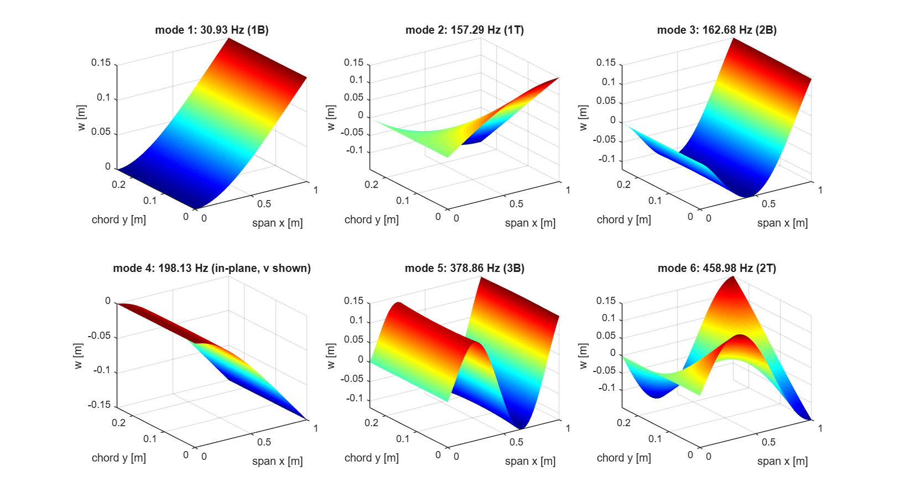

**Are the mode shapes correct? An independent check (V10).** Orthogonality only proves the eigen-solution is self-consistent. To check the *physics*, the wing modes were compared with 1-D theories that share no code with the plate solver.

*Bending* is compared with a Timoshenko cantilever beam (own FE, 200 elements). Its properties come from the laminate: EI = c/d₁₁ with d = D⁻¹ (free edges allow anticlastic curvature), κGA = c·A_s,11, ρA = I₀c, ρI = I₂c.

| Mode | Plate FE [Hz] | Timoshenko beam [Hz] | Difference | MAC (chord-averaged w) |
|---|---|---|---|---|
| 1B | 30.931 | 30.733 | 0.65 % | 1.0000 |
| 2B | 162.676 | 161.917 | 0.47 % | 1.0000 |
| 3B | 378.864 | 377.095 | 0.47 % | 1.0000 |
| 4B | 618.110 | 614.286 | 0.62 % | 1.0000 |
| 5B | 866.213 | 858.898 | 0.85 % | 1.0000 |

*Torsion* is compared with Reissner's shear-deformable plate-strip torsion:

$$GJ = 4D_{66}\,c\left[1-\frac{\tanh(\lambda c/2)}{\lambda c/2}\right],\quad \lambda=\sqrt{A_{s,11}/D_{66}},\quad f_{T1}=\frac{1}{4L}\sqrt{\frac{GJ}{I_0c^3/12+I_2c}}$$

This gives **157.17 Hz vs 157.29 Hz from the plate (0.08 %)**, and the twist shape matches sin(πx/2L) with MAC = 1.0000.

Kirchhoff (no-shear) torsion would give 240.5 Hz, 53 % too high, because the soft core cuts the torsional stiffness to 43 %. This is one more proof that FSDT is necessary. The plate is slightly stiffer than the beam (0.5–0.9 %) because the clamped root also prevents anticlastic curvature locally, which the beam cannot represent.

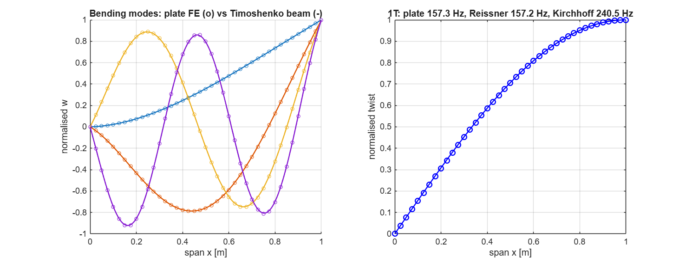

### 5.5 Dynamic gust response

**Design gust:** 1-cosine at V_D, gradient H = 12.5 c̄ = 3.125 m, duration t_g = 2H/V = 0.195 s, so t_g / T₁ = 6.0.

- Analysis: Newmark, Δt = 0.25 ms (≈ 130 steps per T₁), ζ = 2 % Rayleigh (α = 7.19 s⁻¹, β = 1.55·10⁻⁵ s).
- Peak tip deflection: **6.008 mm**.
- **DAF = 1.024**, so the design gust is quasi-static.
- Peak tip acceleration: 0.47 g. This is the signal amplitude an accelerometer would see (input for Milestone 6).

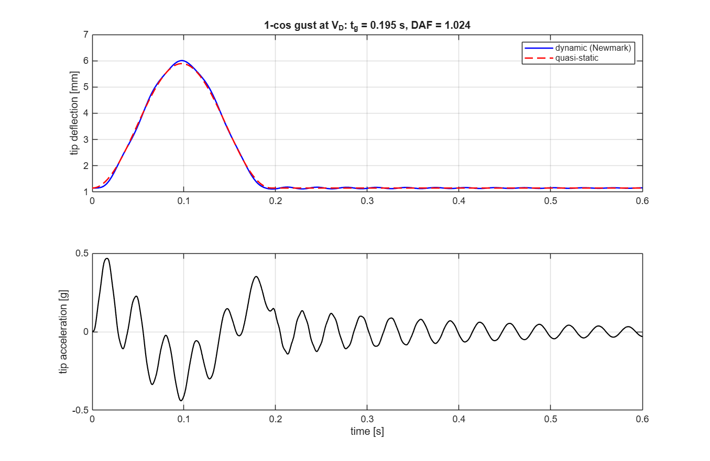

**Gust response spectrum.** A sweep of the gust duration shows when dynamics matter:

| t_g/T₁ | 0.25 | 0.5 | 0.75 | **1.0** | 1.5 | 2 | 3 | 5 | 8 |
|---|---|---|---|---|---|---|---|---|---|
| DAF | 0.73 | 1.33 | 1.62 | **1.69** | 1.54 | 1.32 | 1.01 | 1.01 | 1.01 |

A sharp gust of about 33 ms (one T₁) would amplify the response by 69 %. Damage lowers f₁ and so moves this peak, which is another useful feature for the twist of Milestone 3.

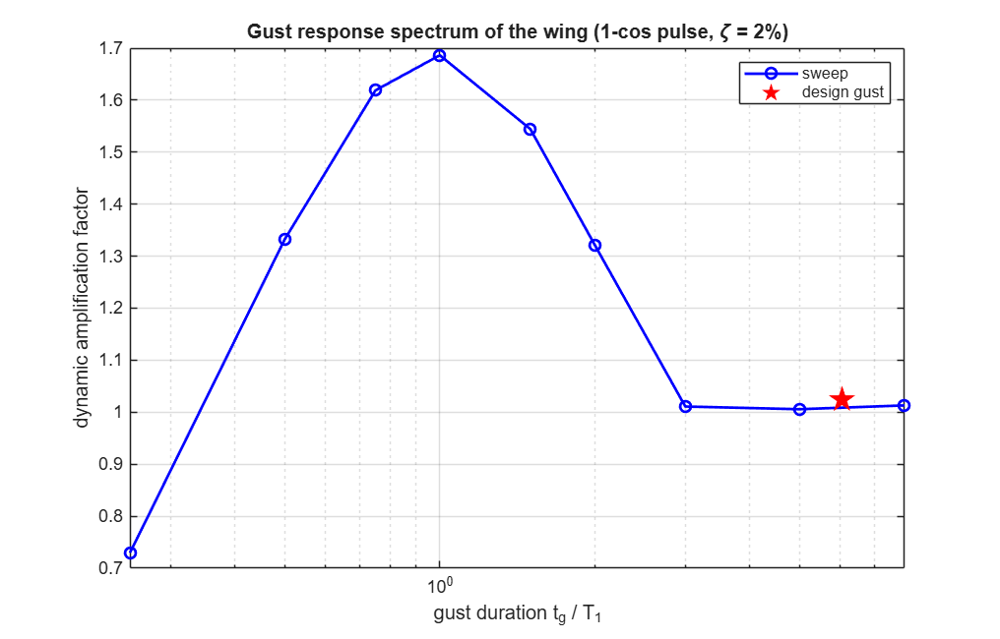

### 5.6 Damage sensitivity — bridge to Milestones 3–5

| Damage | D | Elements | Δf/f modes 1…6 [%] | Δw_tip [%] | min MAC |
|---|---|---|---|---|---|
| Core debond (x = 0.3 m) | 0.9 | 12 | −0.29, −0.15, **−1.14**, 0.00, −0.34, −0.71 | +0.50 | 0.9993 |
| Skin matrix cracks | 0.5 | 12 | −0.07, −0.08, −0.02, −0.02, −0.03, −0.00 | +0.13 | 0.9997 |
| Skin fibre break (near root) | 0.5 | 12 | **−0.52**, −0.35, −0.03, −0.09, −0.04, −0.19 | +1.05 | 0.9948 |
| Core crush (x = 0.6 m) | 0.8 | 10 | −0.12, −0.55, −0.12, −0.01, −0.61, **−1.37** | +0.27 | 0.9695 |

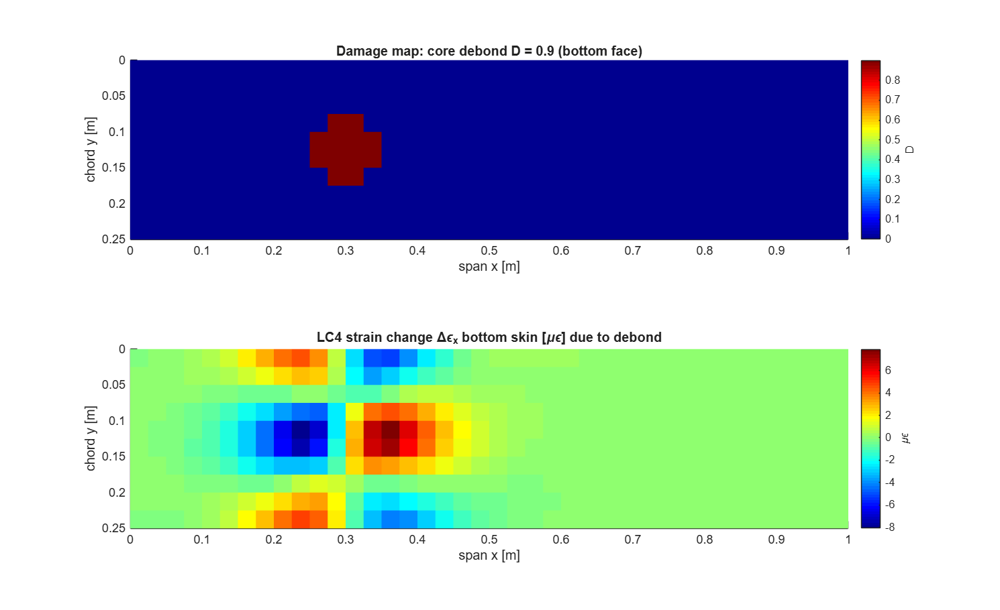

**Key SHM insights, the scientific motivation for the AI part:**

1. **Global features are weak.** Frequency shifts are only 0.02 – 1.4 % and MAC stays > 0.97. Temperature or sensor noise of the same order would hide them, so frequencies alone cannot localise damage.
2. **Each damage type has a fingerprint.**
   - A debond hits **2B** most, because 2B carries the highest core shear at x = 0.3 m.
   - A root fibre break hits **1B**, because it has the highest bending strain at the root.
   - A core crush at x = 0.6 m hits **2T**.

   The *pattern* of shifts across modes encodes location and type. This is exactly what a neural network learns well.
3. **Local strain fields are strong.** The debond creates a ±7 µε dipole around the damage, about 3–5 % of the local strain. That is easily measurable with FBG sensors. This motivates **physics-informed features** in Milestone 4 (mode-shape curvature, strain-energy damage index) and **full-field reconstruction** in Milestone 6.

### 5.7 Computational cost (GNU Octave, single core)

| Operation | Time |
|---|---|
| Assembly (400 elements, cached) | 0.17 s |
| 6 static load cases | 0.01 s |
| 10 modes | 0.04 s |
| Newmark, 2401 steps | 4.2 s |

So one complete "static + modal" sample costs about 0.25 s, and **10 000 DOE samples take under one hour**. MATLAB is typically faster still.

---

## 6. Code map

```
uav_shm_dt/
├── setup_paths.m                  add folders to the path (run first)
├── config/wing_baseline_config.m  Milestone 1: every modelling decision
├── src/materials/   material_library, ply_stiffness, transform_ply,
│                    laminate_section (ABD, As, I0-2), shear_correction
├── src/mesh/        wing_mesh (taper/sweep), rect_mesh, locate_point
├── src/element/     elem_fsdt_q4 (HR / MITC4 / SRI / full), shape_q4, gauss_1d
├── src/assembly/    assemble_system (sparse + cache), apply_bc, dof_index,
│                    wing_layup, build_wing_model
├── src/loads/       lift_distribution (Schrenk + thin airfoil), pressure_load
│                    (singular LE quadrature), point_load, flight_envelope,
│                    gust_load_factor, wing_load_cases
├── src/solvers/     solve_static, solve_modal, solve_newmark, rayleigh_coeffs
├── src/post/        recover_stresses, failure_indices, classify_mode,
│                    plot_field, elem_centroids
├── src/damage/      apply_damage (5 CDM damage modes)
├── src/analytical/  navier_fsdt (static + modal, cross-ply)
├── validation/      val01 ... val09, run_all_validation
├── milestone1/      run_milestone1
├── milestone2/      run_milestone2
├── results/         figures/*.png, data/*.txt|.mat|.md
└── reports/         Milestone1_Report.md, Milestone2_Report.md
```

---

## 7. How to verify in MATLAB

```matlab
>> cd uav_shm_dt
>> setup_paths
>> run_all_validation      % expect "42 / 42 required checks passed."
>> run_milestone2          % ~1 min; compare with the tables above
```

These results should agree with Octave to at least 4 significant figures:

| Check | Expected |
|---|---|
| Navier w̄ (a/h = 10) | 0.662712 |
| FE w̄ (a/h = 10, 24×24) | 0.662438 |
| Leissa λ₁ (32×32) | 3.47174 |
| Wing f₁ … f₃ | 30.931, 157.294, 162.676 Hz |
| Wing LC4 tip deflection (mid-chord) | 5.892 mm |
| Wing LC5 Tsai–Wu at x = 50 mm | 0.0890 |
| Gust DAF | 1.024 |

The last digits of eigenvalues may differ slightly because MATLAB's `eigs` and Octave's ARPACK differ in tolerance handling. Mode **signs** are normalised, so mode shapes match.

---

## 8. Limitations (stated honestly) and what comes next

| Limitation | Effect | Plan |
|---|---|---|
| Equivalent-single-layer FSDT | No sub-laminate kinematics for large delaminations | Approximated by CDM; layer-wise model possible later |
| Linear, small deflection | Fine (w_tip/b < 1 %) | — |
| Quasi-steady aerodynamics | Gust DAF accurate for a clamped wing; no flutter | Unsteady aero if needed |
| Root fully clamped | Root-corner stress singularity | Design values read at x = 50 mm; spring root in Milestone 6 calibration |
| Bilinear element | ~0.3 % frequency error at 40×10 | Enough for the data; Q9 option possible |

**Next — Milestone 3 (Steps 3–4: Design of Experiments + high-fidelity data generation):**

- Latin-hypercube / Sobol sampling over ply angles, thicknesses, materials, loads and damage (type, location, size, severity).
- Batch runs of this solver.
- Outputs per run: frequencies, mode shapes, strains at sensor locations, gust time histories.
- Storage in an HDF5/.mat database ready for feature engineering.

---

## 9. References

1. Reddy, J.N., *Mechanics of Laminated Composite Plates and Shells*, 2nd ed., CRC Press, 2004 (FSDT, Navier solutions, benchmarks).
2. Reddy, J.N., *An Introduction to the Finite Element Method*, 3rd ed., McGraw-Hill, 2006.
3. Bathe, K.J., Dvorkin, E.N., "A four-node plate bending element based on Mindlin/Reissner plate theory and a mixed interpolation," *Int. J. Numer. Meth. Eng.* 21, 1985.
4. Bathe, K.J., *Finite Element Procedures*, 2nd ed., 2014 (MITC, Hellinger–Reissner, Newmark).
5. Pian, T.H.H., Sumihara, K., "Rational approach for assumed stress finite elements," *Int. J. Numer. Meth. Eng.* 20, 1984.
6. MacNeal, R.H., Harder, R.L., "A proposed standard set of problems to test finite element accuracy," *Finite Elem. Anal. Des.* 1, 1985.
7. Leissa, A.W., *Vibration of Plates*, NASA SP-160, 1969.
8. Newmark, N.M., "A method of computation for structural dynamics," *ASCE J. Eng. Mech. Div.* 85, 1959.
9. Tsai, S.W., Wu, E.M., "A general theory of strength for anisotropic materials," *J. Compos. Mater.* 5, 1971.
10. Hashin, Z., "Failure criteria for unidirectional fiber composites," *J. Appl. Mech.* 47, 1980.
11. Matzenmiller, A., Lubliner, J., Taylor, R.L., "A constitutive model for anisotropic damage in fiber-composites," *Mech. Mater.* 20, 1995.
12. Allen, H.G., *Analysis and Design of Structural Sandwich Panels*, Pergamon, 1969.
13. Williams, M.L., "Surface stress singularities resulting from various boundary conditions in angular corners of plates under bending," *Proc. 1st US Natl. Congr. Appl. Mech.*, 1952.
14. Doebling, S.W., Farrar, C.R., Prime, M.B., "A summary review of vibration-based damage identification methods," *Shock Vib. Digest* 30, 1998.
