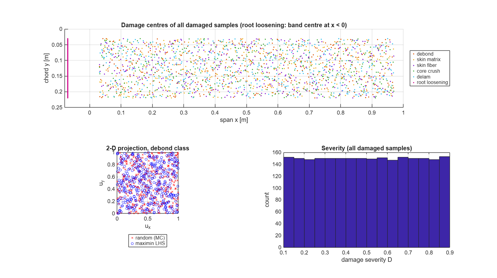
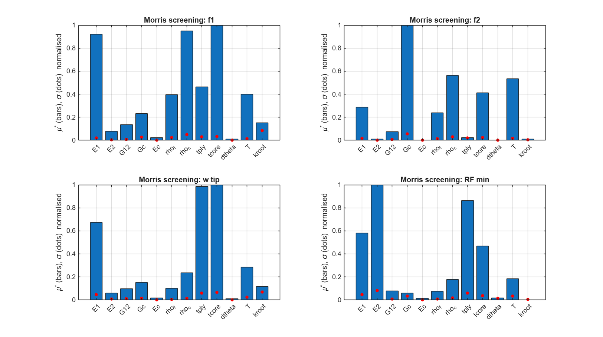
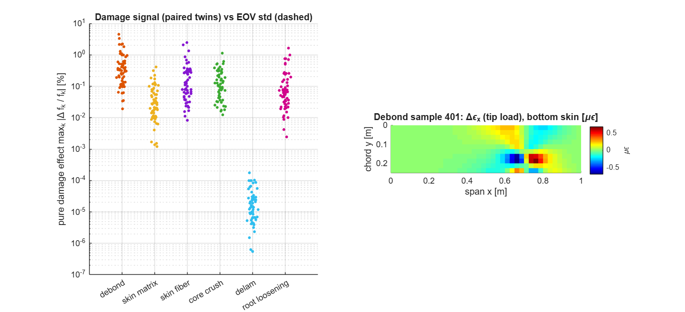
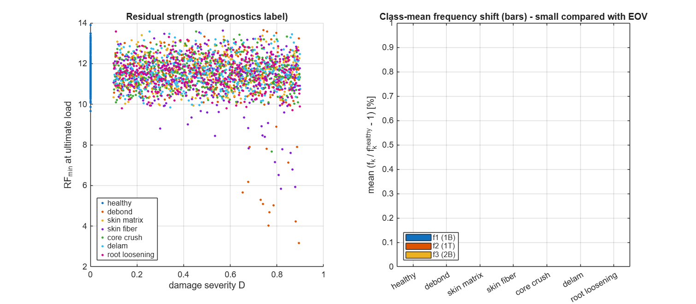
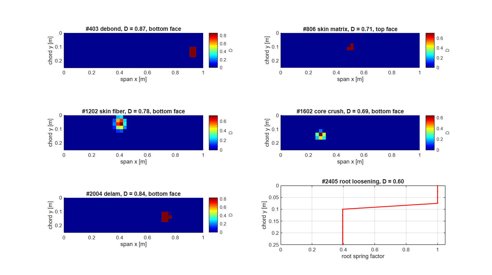
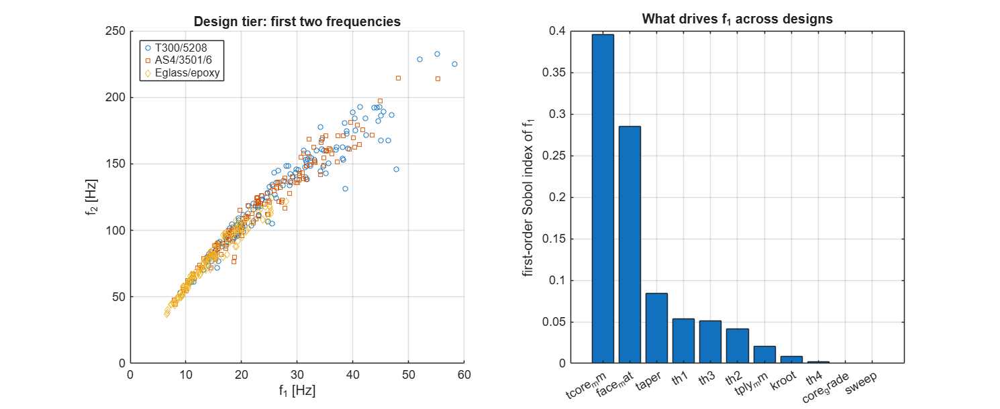

# Milestone 3 — Design of Experiments & High-Fidelity Simulation Database (Steps 3–4)

**Deliverables:**
- *"Comprehensive Parameter Space"* (Step 3);
- *"Large-Scale Simulation Data"* (Step 4).

**Script:** `milestone3/run_milestone3.m` (log: `results/data/M3_summary.txt`)
**Database:** `results/doe/shm_database.mat`, `design_database.mat`, `*_scalars.csv`

---

## 1. Purpose

The AI of Milestones 5–6 can only learn what the data shows it. Step 3 decides **which wings, environments and damages are simulated**, and Step 4 **simulates them with the validated FSDT solver** and stores the results in a fixed, documented format. Three questions drive the design:

1. **What varies in reality?** Manufacturing scatter, temperature, root fixity, and damage type, location, size and severity.
2. **How do we cover that space efficiently?** Space-filling sampling instead of grids.
3. **What must be stored** so that every later step can be done *without re-running the solver*?

---

## 2. Two-tier database strategy

| Tier | Purpose in the digital twin | Samples | Variables |
|---|---|---|---|
| **SHM tier** | Diagnose *this* wing in service: detect, localise, classify and quantify damage despite environmental variability | **2 800** = 7 classes × 400 | 18 |
| **Design tier** | Generalisation: a parametric surrogate / PINN valid across designs; transfer to other wings | **400** healthy designs | 11 |

### 2.1 Why load magnitude is *not* a DOE variable — superposition

The structural model is linear, K d = F. For any load factor n, the response is d(n) = n · d(1). Sampling n would waste a dimension. Instead, the **unit responses** are stored:
- L1: net 1 g flight load (lift minus weight);
- L2: 50 N tip test load;
- the modal forces Γ = Φᵀ F, which with the stored frequencies and damping regenerate *any* dynamic response.

Load magnitude and type are reintroduced cheaply in Milestone 4 as random scaling plus sensor noise. This is the "load magnitudes & types" item of Step 3, handled by physics rather than by brute force.

---

## 3. Variables and ranges (SHM tier)

| Group | Variable | Range | Physical basis |
|---|---|---|---|
| Material scatter | E₁, E₂, G₁₂ (face) scale | ±5 %, ±8 %, ±8 % | Typical batch-to-batch CV of prepreg properties (fibre- vs matrix-dominated) |
| | G_c, E_c (core) scale | ±15 % | Foam density scatter |
| | ρ_f, ρ_c scale | ±3 %, ±10 % | Resin content, foam density |
| Geometry scatter | ply thickness, core thickness | ±5 %, ±3 % | Cured-ply-thickness variation, machining tolerance |
| | global ply misalignment Δθ | ±2° | Hand lay-up tolerance |
| **Environment** | temperature T | −10 … 40 °C | Operational envelope |
| **Boundary** | root fixity k* = k_θ L / D₁₁ | 200 … 5000 (log) | Root fitting compliance (k* → ∞ = clamp) |
| **Damage** | centre x, y | 0.03–0.97 L, 0.12–0.88 c | Anywhere on the wing |
| | radius r, aspect ratio | 15–60 mm, 0.6–1.4 | Barely-visible impact to large debond |
| | severity D | 0.1 – 0.9 | Stiffness loss (1 − D) |
| | face | top / bottom | Impact side, inside/outside |

**Damage classes (stratified, 400 each):** healthy, core debond, skin matrix cracking, skin fibre breakage, core crush, delamination, root loosening.
- Impact-type damages (fibre breakage, core crush) use a Gaussian severity profile; the others are uniform.
- Strengths degrade together with stiffness, so the strength result is a **residual strength**.

### 3.1 Environmental model (temperature)

Below T_g, epoxy-matrix and foam moduli fall roughly linearly with temperature. With reference T₀ = 20 °C:

$$P(T) = P_{20}\,[1-a\,(T-T_0)],\qquad a_{matrix}=0.003\ /^\circ C,\quad a_{fibre}=0.0002\ /^\circ C,\quad a_{core}=0.0025\ /^\circ C$$

This applies to E₂, G₁₂, G₁₃, G₂₃ and the matrix strengths of the faces, to E₁/X of the fibres, and to all core properties. A 30 °C rise lowers f₂ (torsion) by 2.4 %. That is **larger than most damage effects**, and it is the central difficulty of real SHM.

### 3.2 Boundary-condition model (elastic root)

The clamp is replaced by distributed rotational springs at the root. Translations stay fixed.

$$k_b = k^*\frac{D_{11}}{L},\qquad k_t = k^*\frac{D_{22}}{L}\qquad\text{per unit root length}$$

| k* | 30 | 100 | 300 | 1000 | 3000 | ∞ |
|---|---|---|---|---|---|---|
| Δf₁ [%] | −5.4 | −1.7 | −0.59 | −0.18 | −0.06 | 0 |

*Root loosening* (a 7th damage class: loose bolts or a failed bond) multiplies the springs in a chord-wise band by (1 − D).

### 3.3 Design tier variables

- Four face ply angles, each −90°…90° (symmetric layup preserved).
- Ply thickness 0.10–0.20 mm and core thickness 8–30 mm, i.e. the **thickness ratio** t_f / t_c.
- Face material: T300/5208, AS4/3501-6 or E-glass/epoxy.
- Core grade 0.5–2 (log). Gibson–Ashby foam scaling G ∝ ρ², so ρ_c ∝ √grade.
- Planform taper 0.5–1 and LE sweep 0–20°.
- Root fixity.

---

## 4. Sampling theory

### 4.1 Latin Hypercube Sampling (McKay, Beckman & Conover 1979)

- Each variable's range is split into N equal-probability strata.
- Each stratum is sampled exactly once, and the strata of different variables are randomly paired.
- Result: perfect one-dimensional coverage for any N, and an estimator variance never worse than Monte-Carlo for monotone responses.

### 4.2 Maximin optimisation (Morris & Mitchell 1995)

Among Latin hypercubes, prefer the one whose closest pair of points is farthest apart:

$$X^* = \arg\max_X\ \min_{i\neq j}\ \lVert x_i-x_j\rVert_2$$

Implementation (`src/doe/lhs_maximin.m`, no toolbox required):
1. Take the best of 20 random LHS designs.
2. Apply 400 greedy element exchanges within columns. These preserve the Latin property and are accepted only if the minimum distance increases.

### 4.3 Uniformity metric — centred L2-discrepancy (Hickernell 1998)

$$CD_2^2=\left(\tfrac{13}{12}\right)^k-\frac{2}{n}\sum_i\prod_j\left(1+\tfrac{|z_{ij}|}{2}-\tfrac{z_{ij}^2}{2}\right)+\frac{1}{n^2}\sum_{i,l}\prod_j\left(1+\tfrac{|z_{ij}|}{2}+\tfrac{|z_{lj}|}{2}-\tfrac{|x_{ij}-x_{lj}|}{2}\right),\quad z=x-\tfrac12$$

Lower is more uniform.

### 4.4 Stratification by class

An **independent** maximin LHS is drawn for each damage class. Every class therefore:
- has equal size (balanced data for classification);
- covers its own location, size and severity space uniformly.

---

## 5. Sensitivity analysis theory

### 5.1 Morris elementary effects (Morris 1991; Campolongo et al. 2007)

- Run r random one-at-a-time trajectories on a p-level grid. Each trajectory costs k + 1 model runs.
- Each factor's elementary effect is

$$EE_i=\frac{y(\mathbf x+\Delta\mathbf e_i)-y(\mathbf x)}{\Delta},\qquad \mu_i^*=\frac1r\sum|EE_i|,\qquad \sigma_i=\mathrm{std}(EE_i)$$

- μ* ranks overall influence; σ flags non-linearity or interactions.
- Setup: k = 12 variability factors, r = 20, so 260 runs.

### 5.2 First-order Sobol indices (variance decomposition)

$$S_i=\frac{\mathrm{Var}_{x_i}\!\left(E[y\mid x_i]\right)}{\mathrm{Var}(y)}$$

S_i is estimated from the already computed LHS samples by binning x_i into 10 equal-count bins (`sobol_binned.m`), so no extra runs are needed. Σ S_i ≈ 1 means the response is additive.

### 5.3 Paired "healthy twin" analysis

To separate the **pure damage effect** from the variability, a subset of damaged samples (60 per class) is re-simulated with identical material, temperature and boundary values but **no damage**. The difference is then caused only by the damage, and it can be compared directly with the healthy variability (EOV std).

---

## 6. What one high-fidelity simulation computes (`src/doe/run_sample.m`)

1. **Model:** perturbed laminate, elastic root (springs scaled locally for root loosening), damaged sections (continuum damage, strengths degraded).
2. **Modal analysis**, 8 modes:
   - frequencies;
   - automatic mode labels (1B, 1T, …);
   - mass-normalised w-shapes at all 451 nodes;
   - bottom-skin modal strains at all 400 elements.
3. **Static unit cases L1, L2:** deflection fields, top and bottom surface strains (ε_x, ε_y, γ_xy), tip deflection, twist.
4. **Residual strength** at ultimate load (n_ult · L1): Tsai–Wu, Hashin, core shear and interlaminar reserve factors, read at x ≥ 50 mm (Milestone 2 root singularity).
5. **Gust response** by **exact modal superposition** (`modal_response.m`):
   - every mode is integrated exactly for piecewise-linear loading (first-order-hold matrix exponential);
   - plus a static correction for the truncated modes (mode-acceleration method);
   - validated against full Newmark: errors 0.03 % in displacement and 0.04 % in acceleration (V11), and about 1000× faster.

   Two gusts are computed: the design gust and a sharp gust with t_g = T₁.
6. **Quality checks:** global equilibrium and eigen-residual ‖Kφ − ω²Mφ‖/‖Kφ‖ on the free DOFs.

Damping: Rayleigh coefficients are fitted **once** on the nominal wing (ζ = 2 % at modes 1 and 5). Damping is a material and joint property, so a damaged wing with shifted frequencies gets consistently shifted damping ratios.

---

## 7. Results — sample plan quality

| | SHM tier | Design tier |
|---|---|---|
| Samples | 2 800 (7 × 400) | 400 |
| Variables | 18 | 11 |
| Min. inter-point distance, maximin-LHS vs random | 0.803 vs 0.708 (**+13 %**) | 0.452 vs 0.405 |
| Centred L2 discrepancy, LHS vs random | 0.312 vs 0.359 (**−13 %**) | 0.110 vs 0.141 |



- Damage centres cover the whole planform uniformly for every class.
- Severity is flat over 0.1–0.9, as expected from Latin stratification.
- The 2-D projection shows LHS points spread evenly where random points cluster and leave gaps.

---

## 8. Results — database quality checks

| Check | Result |
|---|---|
| Successful simulations | **2800 / 2800** (SHM), **400 / 400** (design): zero failures |
| Max. global equilibrium error | 1.2 × 10⁻¹¹ |
| Max. eigen-residual ‖Kφ − ω²Mφ‖/‖Kφ‖ | 2.3 × 10⁻¹¹ |
| Run time per sample (Octave, 4 parallel workers) | 2.05 s (SHM), 7.05 s (design: tapered meshes, no element cache) |
| Nominal mode sequence | 1B 1T 2B 1I(in-plane) 3B 2T 4B 3T |
| Mode re-ordering, SHM tier | 0.0 % of samples |
| Mode re-ordering, design tier | **64.8 %** of designs |

> **Consequence for Milestone 4.** Across designs, the order of modes changes in two out of three wings: torsion can drop below 2nd bending, an in-plane mode can move, and so on. Features must therefore be matched by **mode type / shape (MAC tracking)**, never by mode index alone. The database stores the automatic mode labels to make this easy.

**Bug found and fixed during QA.** The first design-tier run sampled the foam grade from 3–100× instead of 0.5–2×, because the bounds of a log-scaled variable must be given as log₁₀ exponents. This produced semi-wings of 3.3 kg and negative tip deflections. It was caught by a physical plausibility check. The convention is now documented in `doe_config.m` and the tier was regenerated. The SHM tier was not affected.

---

## 9. Results — sensitivity analysis (healthy wing)

### 9.1 Morris screening (260 runs), μ* normalised per output

| Factor | f₁ (1B) | f₂ (1T) | f₃ (2B) | w_tip | twist | RF_min |
|---|---|---|---|---|---|---|
| E₁ | 0.92 | 0.29 | 0.59 | 0.67 | 0.29 | 0.58 |
| E₂ | 0.08 | 0.01 | 0.05 | 0.06 | 0.01 | **1.00** |
| G₁₂ | 0.14 | 0.07 | 0.09 | 0.10 | 0.07 | 0.08 |
| **G_c (core shear)** | 0.23 | **1.00** | **1.00** | 0.15 | **1.00** | 0.06 |
| E_c | 0.02 | 0.00 | 0.01 | 0.02 | 0.00 | 0.01 |
| ρ_f | 0.40 | 0.24 | 0.36 | 0.10 | 0.00 | 0.08 |
| **ρ_c** | 0.95 | 0.56 | 0.85 | 0.24 | 0.00 | 0.18 |
| t_ply | 0.47 | 0.02 | 0.15 | 0.98 | 0.38 | 0.86 |
| **t_core** | **1.00** | 0.41 | 0.73 | **1.00** | 0.60 | 0.47 |
| Δθ | 0.01 | 0.00 | 0.01 | 0.01 | 0.03 | 0.02 |
| **T** | 0.40 | 0.54 | 0.62 | 0.29 | 0.54 | 0.19 |
| k_root | 0.15 | 0.01 | 0.08 | 0.12 | 0.01 | 0.00 |



**Physical interpretation:**

- **Bending (f₁, w_tip)** is governed by the sandwich depth (t_core), face stiffness (E₁, t_ply) and mass (ρ_c). This is classic sandwich bending, D ≈ E_f t_f d²/2.
- **Torsion and higher modes (f₂, f₃, twist)** are governed by **core shear G_c**. This is the FSDT shear effect of Milestones 1–2: these modes would be wrong with k = 5/6 or with CLT.
- **Strength (RF_min)** is governed by **E₂ (matrix) and t_ply**, because the critical failure is matrix tension in the 90° ply.
- **Temperature** has a mid-level influence on every frequency. It is the main environmental confounder.
- **Ply misalignment (±2°) and core E_c** are negligible. They could be dropped from future DOEs, which is exactly what screening is for.
- σ (red dots) ≪ μ* everywhere, so the responses are almost linear and additive in these ranges.

### 9.2 First-order Sobol indices (from the 400 healthy LHS samples, bias-corrected)

| | E₁ | G_c | ρ_f | ρ_c | t_ply | t_core | T | others | **Σ S_i** |
|---|---|---|---|---|---|---|---|---|---|
| f₁ | 0.21 | 0.04 | 0.09 | 0.26 | 0.08 | 0.25 | 0.08 | < 0.04 | **1.03** |
| f₂ | 0.03 | **0.56** | 0.08 | 0.20 | 0.00 | 0.06 | 0.13 | < 0.03 | **1.08** |
| f₃ | 0.08 | 0.38 | 0.09 | 0.25 | 0.01 | 0.12 | 0.12 | < 0.03 | **1.08** |
| w_tip | 0.15 | 0.00 | 0.01 | 0.04 | 0.37 | 0.35 | 0.05 | < 0.01 | **0.97** |

- Σ S_i ≈ 1 confirms that the responses are **additive** (no significant interactions), in agreement with Morris.
- The ranking from both methods agrees.
- A raw (uncorrected) binned estimator gave Σ ≈ 1.27. The upward bias of (n_b − 1)/(n − 1) per factor is now removed analytically (`sobol_binned.m`).

---

## 10. Results — damage signal versus variability (the central SHM finding)

### 10.1 Global (frequency) signal

| Damage class | Pure damage effect max_k \|Δf_k/f_k\|, median | 90th percentile | Median signal / EOV std |
|---|---|---|---|
| Core debond | 0.33 % | 1.29 % | 0.10 |
| Skin matrix cracking | 0.03 % | 0.12 % | 0.01 |
| Skin fibre breakage | 0.11 % | 0.54 % | 0.03 |
| Core crush | 0.11 % | 0.39 % | 0.03 |
| Delamination (in-face) | ≈ 0 (≤ 2·10⁻⁶) | ≈ 0 | 0.00 |
| Root loosening | 0.06 % | 0.50 % | 0.02 |
| **Healthy variability (EOV std)** | **2.0 – 3.2 %** per mode | | |

**Classical frequency-only novelty test** (any f₁…f₆ outside the healthy mean ± 3σ): 0.5 % false alarms, but only **1 %** of debonds and **0 %** of all other damages detected.



> **Finding 1.** Under realistic manufacturing scatter and temperature variation, natural frequencies alone **cannot** detect the damages of interest. The variability is 10–100 times larger than the damage signal. This is the well-known central problem of vibration-based SHM, and it is the scientific justification for the physics-informed features and AI of Milestones 4–5.

### 10.2 Local (strain-field) signal

The pure damage effect on the bottom-skin strain field under the 50 N tip load, max|Δε_x| / max|ε_x|:

| Class | median | 90th pct | **Median / EOV shape-variability** |
|---|---|---|---|
| Debond | 0.40 % | 1.54 % | **13×** |
| Skin matrix | 0.89 % | 3.37 % | **30×** |
| Skin fibre | 1.37 % | 30.0 % | **46×** |
| Core crush | 0.22 % | 0.56 % | ≈ 7× |
| Root loosening | 0.64 % | 4.78 % | **22×** |
| Delamination | 0.00 % | 0.00 % | 0 |

The **raw** strain variability from EOV is 4.3 % (median coefficient of variation per element), larger than most damage signals. However, EOV acts almost entirely as a **global scaling** of the field: stiffer material or a thicker core makes *all* strains smaller together. After removing **one scale factor per sample**, the remaining variability of the field **shape** is only **0.03 %**. Damage, by contrast, creates a **local pattern**, such as the dipole around the debond in the figure.

> **Finding 2 — the key design rule for Milestone 4.** Use **spatially normalised strain-field / mode-shape features**: ratios, residuals after global scaling, or curvature. They suppress environmental variability by about two orders of magnitude while keeping the local damage signature. This is where the physics-informed feature engineering earns its name.
>
> **Caveat.** These numbers are noise-free. Realistic strain-sensor noise (about 1 µε, roughly 0.4 % of the peak strain here) will set the practical detection floor. Noise is added in Milestone 4 so its effect is quantified, not assumed.

### 10.3 Physical detectability limit: in-face delamination

A delamination *inside* a 0.5 mm carbon face changes the global response by ≤ 2·10⁻⁶. The damage *is* applied: the section's shear correction factor changes from 0.095 to 0.120. But in a sandwich:
- the **core** carries the transverse shear;
- the delaminated sub-laminates still carry their full membrane load.

So bending stiffness is unchanged. This is a real physical fact, not a modelling bug. Such delaminations are found in practice with **ultrasonic / guided-wave** methods, not low-frequency vibration or strain.

> **Finding 3.** The digital twin must **report it cannot see** this damage class rather than guess. Plan for Milestones 4–5:
> - keep the class in the database, honestly labelled;
> - evaluate the classifier's per-class probability of detection;
> - list guided-wave sensing as the recommended extension.
>
> Delaminations at the **face–core interface** are covered by the debond class, which *is* detectable.

### 10.4 Residual strength (prognostics label)

| Class | RF_min mean ± std | worst sample |
|---|---|---|
| Healthy | 11.58 ± 0.72 | 9.66 |
| Debond | 11.36 ± 1.31 | **3.17** |
| Skin fibre | 11.36 ± 1.08 | 5.85 |
| Core crush | 11.56 ± 0.75 | 7.67 |
| Skin matrix | 11.56 ± 0.73 | 9.93 |
| Delamination | 11.58 ± 0.74 | 9.85 |
| Root loosening | 11.54 ± 0.73 | 9.71 |

Severe debonds and fibre breakage can cut the reserve factor by **3×**. Strength loss, not stiffness loss, is what matters for safety, so RF is the **prognostics target** for Step 9 (remaining-useful-life estimation).




**Gust sensitivity.** The sharp-gust dynamic amplification factor is 1.686 for every sample. This is a consistency check, not missing physics. The sharp gust is defined relative to each sample's own period (t_g = T₁), and the response is dominated by mode 1 with ζ₁ ≈ 2 %. The 1-cos shock-response spectrum value at t_g/T₁ = 1, ζ = 2 % is ≈ 1.69, independent of stiffness.

---

## 11. Results — design tier

| Face material | n | f₁ range [Hz] | w_tip at 1 g [mm] | RF_min range |
|---|---|---|---|---|
| T300/5208 | 133 | 8.95 – 58.30 | 0.29 – 20.65 | 0.94 – 24.27 |
| AS4/3501-6 | 134 | 7.83 – 55.27 | 0.38 – 22.40 | 1.69 – 25.36 |
| E-glass/epoxy | 133 | 6.57 – 28.00 | 1.13 – 38.13 | 0.77 – 16.42 |

- **f₁ first-order Sobol ranking:** core thickness (0.40) > face material (0.29) > taper (0.08) > θ₁ (0.05) > θ₃ (0.05).
- A few designs have RF < 1. These are genuinely under-designed wings. They are kept on purpose, so the surrogate also learns where the design space becomes unsafe.



---

## 12. Database contents (for Milestones 4–6)

Files are in `results/doe/`. The `.mat` files are MATLAB v7, readable in Python with `scipy.io.loadmat`. Large arrays are single precision.

| Field | Size (SHM) | Content |
|---|---|---|
| `U`, `P`, `var_names`, `units` | 2800 × 18 | Inputs: unit-cube and physical values |
| `cls`, `classes`, `Dmap`, `root_factor` | 2800, 2800 × 400, 2800 × 11 | **Labels:** class, element-wise damage severity map, root spring factors |
| `freq`, `zeta`, `mode_type`, `mode_order` | 2800 × 8 | Modal data and automatic mode labels |
| `Wmodes` | 451 × 8 × 2800 | Mass-normalised w-mode shapes at every node |
| `Emodes` | 400 × 3 × 8 × 2800 | Bottom-skin modal strains (ε_x, ε_y, γ_xy) per element |
| `w_static`, `eps_bot`, `eps_top` | 451 × 2 × N, 400 × 3 × 2 × N | Static fields for L1 (1 g) and L2 (tip load) |
| `tipw`, `twist` | N × 3 × 2, N × 2 | Tip deflection LE / mid / TE, twist |
| `gam_L1`, `gam_L2` | N × 8 | Modal forces, which regenerate any dynamic response |
| `RF`, `crit_elem`, `crit_hashin_mode` | N × 6 | Residual strength at ultimate load |
| `gust` | N × 5 | DAF, peak tip w / a, peak root strain, sharp-gust DAF |
| `ok`, `msg`, `time`, `qc` | N | Run status and quality checks |

Also included:
- `shm_scalars.csv` / `design_scalars.csv`: one row per sample with inputs and scalar outputs, for Excel / pandas.
- `morris.mat`, `twins.mat`: the sensitivity and paired-twin studies.

---

## 13. How to reproduce / verify in MATLAB

```matlab
>> setup_paths
>> run_all_validation   % 56/56 checks (incl. new V10 mode-shape and V11 modal-solver checks)
>> run_milestone3       % builds designs, runs all simulations (resumable), analysis
```

**Runtime:** about 1.6 h of serial CPU for all 3 200 simulations in Octave; MATLAB is usually faster. To parallelise:
- set `USE_PARFOR = true` (Parallel Computing Toolbox); or
- open several MATLAB windows and call `generate_database('shm', c, 4, 'results/doe')` with c = 1…4, one per window.

The run is check-pointed, so an interrupted run continues where it stopped.

**Quick check without re-running everything:** load the supplied `shm_scalars.csv` and compare a few rows. For example, sample 1 is healthy with f₁ ≈ 30.9 Hz, and the per-class means are in Section 10.4.

---

## 14. Summary

| Step 3–4 goal (workflow diagram) | Delivered |
|---|---|
| Vary ply orientations, thickness ratios, materials | Design tier: 4 ply angles, t_f / t_c, 3 materials, core grade, taper, sweep |
| Load magnitudes & types | Linear superposition: unit 1 g, tip and gust responses plus modal forces (any n) |
| Boundary conditions | Elastic root fixity (log-uniform) and a root-loosening damage class |
| Damage scenarios | 6 physical damage classes, stratified, with location, size, severity, face |
| Batch high-fidelity simulation | 3 200 FSDT runs, 0 failures, checked for equilibrium and eigen-residuals |
| Extract outputs | Frequencies, mode shapes, modal strains, static fields, strength, gust response |
| Comprehensive parameter space / large-scale data | Maximin-LHS (+13 % spacing, −13 % discrepancy), 228 MB database |

**Three scientific findings carry into Milestones 4–5:**
1. Frequencies alone are swamped by EOV (signal/noise ≈ 0.01–0.1).
2. Spatially normalised strain-field features recover a 7–46× margin.
3. In-face delamination is physically invisible to this sensing approach. The twin must say so.

## 15. References

1. McKay, M.D., Beckman, R.J., Conover, W.J., "A comparison of three methods for selecting values of input variables," *Technometrics* 21, 1979.
2. Morris, M.D., Mitchell, T.J., "Exploratory designs for computational experiments," *J. Stat. Plan. Inference* 43, 1995.
3. Hickernell, F.J., "A generalized discrepancy and quadrature error bound," *Math. Comput.* 67, 1998.
4. Morris, M.D., "Factorial sampling plans for preliminary computational experiments," *Technometrics* 33, 1991.
5. Campolongo, F., Cariboni, J., Saltelli, A., "An effective screening design for sensitivity analysis of large models," *Environ. Model. Softw.* 22, 2007.
6. Saltelli, A. et al., *Global Sensitivity Analysis: The Primer*, Wiley, 2008.
7. Sohn, H., "Effects of environmental and operational variability on structural health monitoring," *Phil. Trans. R. Soc. A* 365, 2007.
8. Farrar, C.R., Worden, K., *Structural Health Monitoring: A Machine Learning Perspective*, Wiley, 2013.
9. Gibson, L.J., Ashby, M.F., *Cellular Solids*, 2nd ed., Cambridge, 1997.
10. Franklin, G.F., Powell, J.D., Workman, M., *Digital Control of Dynamic Systems*, 3rd ed. (first-order-hold discretisation).
11. Giurgiutiu, V., *Structural Health Monitoring with Piezoelectric Wafer Active Sensors*, 2nd ed., Academic Press, 2014 (guided waves for delamination).
