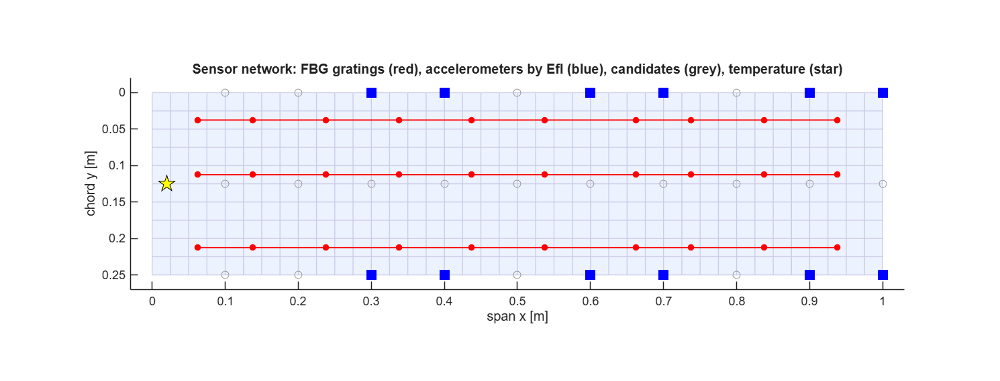
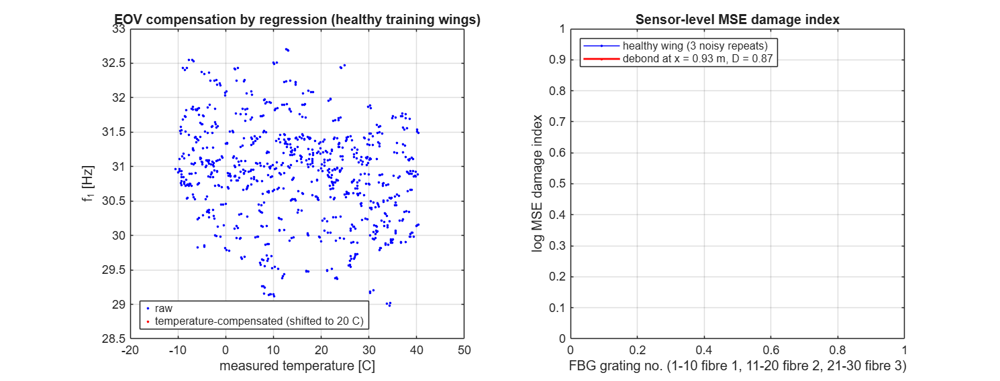
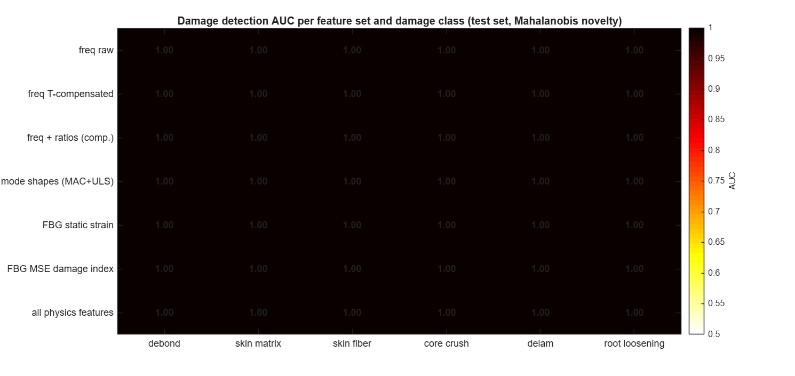
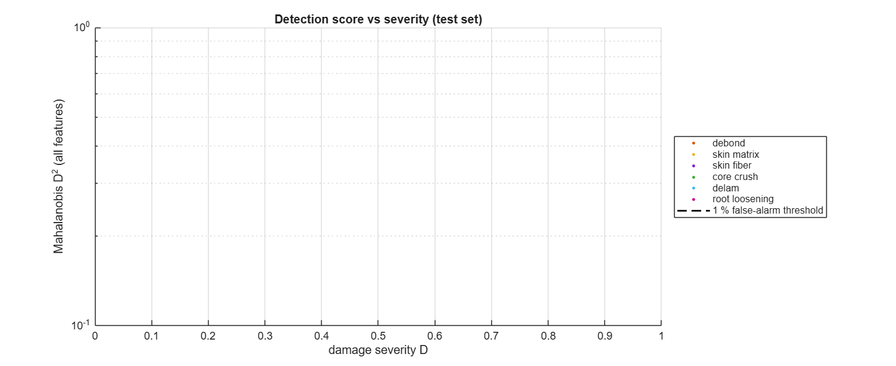
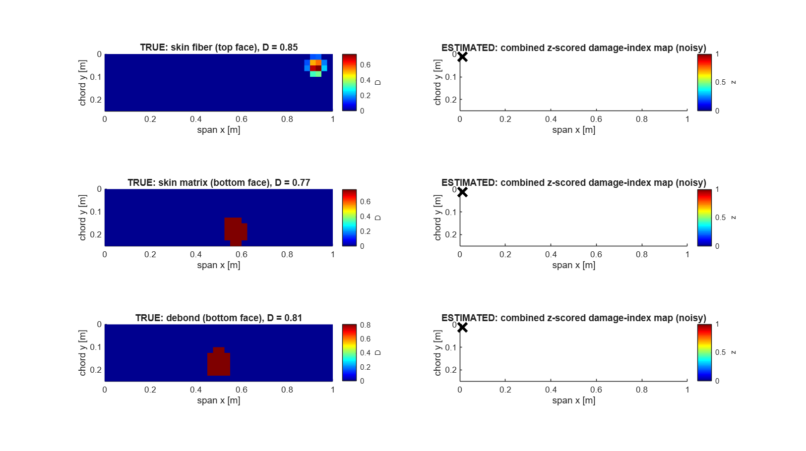

# Milestone 4 — Data Processing & Physics-Informed Feature Engineering (Step 5)

**Deliverable of this step:** *"Curated Feature Dataset"*
**Script:** `milestone4/run_milestone4.m` (log: `results/data/M4_summary.txt`, ~50 s)
**Datasets:** `results/features/shm_features.mat / .csv`, `results/features/design_io.mat`

---

## 1. Purpose

Milestone 3 produced *ideal, noise-free* simulations. Milestone 4 turns them into what a **real** digital twin would see and learn from. It answers four questions:

1. **Which sensors** does the wing carry, and where? (Section 2)
2. **What would those sensors actually read**, including noise, calibration error and identification error? (Section 3)
3. **Which quantities ("features")** carry the damage information while *suppressing* temperature and manufacturing effects? (Section 4)
4. **How good are those features**, before any deep learning? (Section 6)

The guiding finding from Milestone 3: environmental and operational variability (EOV) shifts frequencies 10–100× more than damage does, but it acts almost as a **global scaling** of the strain field (shape variability only 0.03 %). Every feature below is designed around that fact.

---

## 2. Sensor network

| Sensor | Number | Location | Measures |
|---|---|---|---|
| FBG strain gratings (optical fibre) | 3 fibres × 10 gratings × **2 skins** = 60 | bottom and top skin, y/c = 0.2, 0.5, 0.8; x = 0.05–0.95 L | ε_x, static and dynamic |
| Accelerometers (z) | 12 | chosen by Effective Independence | modal frequencies and shapes |
| Temperature | 1 | root | T, for EOV compensation |
| Full-field strain (ground test, e.g. DIC) | 400 elements × 3 components × 2 skins | whole wing | dense maps for localisation and CNNs |

### 2.1 Effective Independence (Kammer 1991)

For target mode shapes Φ at candidate points, the Fisher information matrix of the modal coordinates is Q = ΦᵀΦ. The contribution of each candidate to the rank / volume of Q is

$$E_{D,i} = \left[\Phi(\Phi^T\Phi)^{-1}\Phi^T\right]_{ii},\qquad 0\le E_{D,i}\le 1 .$$

Candidates with the smallest E_D are removed one by one until 12 remain. This keeps the five flexural modes (1B, 1T, 2B, 3B, 2T) linearly independent and maximally observable in noise.

**Engineering correction.** Unconstrained EfI over all 451 nodes put the sensors in **adjacent pairs**, because it assumes independent noise, so near-duplicate points look informative. Following practice, candidates were restricted to a mounting grid: every 0.1 L on the leading edge, mid-chord and trailing edge, ≥ 100 mm apart. Result:
- 6 LE/TE pairs at x = 0.3, 0.4, 0.6, 0.7, 0.9, 1.0 m, which separate bending (in-phase) from torsion (anti-phase);
- Fisher condition number 4.3;
- maximum off-diagonal auto-MAC 0.098, so all modes are clearly distinguishable.

### 2.2 Why both skins carry sensors — a finding of this milestone

The first version had sensors on the bottom skin only. Localisation of skin damage was then **89–100 % successful on the instrumented skin but 0–2 % on the other one**. In a sandwich, damage in one face barely disturbs the strains of the opposite face, because the core decouples them. With both skins instrumented, skin-damage localisation works on either face (Section 6.3).

> **Design rule:** a sandwich wing needs strain sensors on **both** skins.

---

## 3. Virtual measurements (noise and error model)

Every simulated wing is "measured" **R = 3 times** with independent errors, giving 2 800 × 3 = **8 400 measurement records**.

| Error source | Model | Value |
|---|---|---|
| Temperature sensor | Gaussian | σ = 0.5 °C |
| Modal frequency identification (OMA) | relative Gaussian | σ = 0.05 % |
| Mode-shape identification | Gaussian, × max\|φ\| | σ = 1 % |
| Dynamic FBG modal strain | Gaussian, × max\|ε\| | σ = 2 % |
| Static FBG strain | additive + gauge-factor (gain) error | 1 µε + 0.5 % |
| Tip-test load | relative | 1 % |
| Full-field strain (DIC) | additive | 2 µε |

**Mode pairing.** z-accelerometers cannot see the in-plane mode, so only flexural modes are identified. Identified modes are paired with the reference modes by **maximum MAC**, never by index, and their sign is aligned. Paired MAC is ≥ 0.9 in 98.8 % of records. The remaining 1.2 % are soft wings where 1T and 2B approach each other and their shapes mix (**mode veering**), a real phenomenon that the AI must tolerate.

---

## 4. Physics-informed features (117 per record)

All features are measured **relative to the baseline**: the as-designed healthy wing at 20 °C, which the twin stores at commissioning.

| Group | n | Definition | Physical reason |
|---|---|---|---|
| `freq` | 5 | f_k of 1B, 1T, 2B, 3B, 2T | Global stiffness / mass |
| `ratio` | 4 | f_k / f₁ | A uniform stiffness or mass change scales *all* frequencies, so it cancels; local damage does not |
| `mac` | 5 | 1 − MAC(φ_k, φ_k^ref) | Change of mode shape |
| `uls` | 12 | Uniform-load-surface residual (below) | Modal flexibility, dominated by low modes |
| `strain` | 60 | Static strain-**shape** residual, both skins (below) | Local stiffness change under a known load |
| `msedi` | 30 | Modal-strain-energy damage index per FBG (below) | Energy redistribution caused by local damage |
| `temp` | 1 | Measured T | Lets the models account for EOV |

### 4.1 Global-scale removal (the core idea)

For any measured field u and its reference u₀, the best global scale factor is removed first:

$$a=\frac{u_0^T u}{u_0^T u_0},\qquad r=\frac{u/a-u_0}{\max|u_0|}.$$

Temperature, batch stiffness, thickness and load-magnitude errors mostly change **a**. Damage changes **r**.

### 4.2 Uniform load surface (Pandey & Biswas 1994; Wu & Law 2004)

With mass-normalised measured modes, modal flexibility and the deflection under a unit load at every sensor are

$$\mathbf G=\Phi\,\Omega^{-2}\,\Phi^T,\qquad \mathbf u=\mathbf G\,\mathbf 1 .$$

Flexibility converges quickly with few modes (1/ω²), so the low modes we can measure are enough.

### 4.3 Modal-strain-energy damage index (Stubbs / Cornwell, sensor form)

$$F_{sk}=\frac{\varepsilon_{sk}^2}{\sum_s\varepsilon_{sk}^2},\qquad \beta_s=\frac{\sum_k F_{sk}+\lambda}{\sum_k F^{ref}_{sk}+\lambda},\qquad \lambda=0.5\,\overline{F^{ref}},\qquad x_s=\ln\beta_s$$

- Energy **fractions** are scale-free, so global EOV cancels.
- The noise floor λ is essential. Where the reference modal strain is ≈ 0 (free tip, nodal lines), noise divided by a tiny number would explode the index. This is the role of the "+1" in Stubbs' original formulation.
- The dense (full-field) version uses all three strain components:

$$U_e=\sum_{c}\varepsilon_{e,c}^2 .$$

  Using ε_x alone failed. A core debond disturbs shear transfer, so it appears mainly in γ_xy and ε_y.

### 4.4 Data cleaning results

| Check | Result |
|---|---|
| Failed / non-finite simulations | 0 |
| Frequencies not ascending | 0 |
| Duplicate input vectors | 0 |
| Healthy outliers (\|z\| > 5) | 0 |
| RF range, mass range | 3.17 – 13.90; 0.624 – 0.745 kg (physical) |

---

## 5. Leakage-free split, EOV compensation, standardisation

1. **Split by wing, stratified by class:** 70 / 15 / 15 % → 1 960 / 420 / 420 wings. All 3 noisy records of one wing stay in the same subset. Otherwise the model would see the test wing during training (data leakage), and scores would be optimistic.
2. **Temperature compensation by regression** (Sohn 2007; Peeters & De Roeck 2001). Every feature is regressed on the measured T *using healthy training wings only*, and the trend is removed:

$$x_j^{c}=x_j-(a_j+b_jT).$$

   - Correlation of f₁ with T drops from −0.197 to 0.000; for f₂/f₁, from −0.239 to 0.000.
   - The fitted slope of f₁ is −0.031 %/°C.
3. **Standardisation** (z-score) with training statistics only. The normalisation constants are saved with the data, so the digital twin applies exactly the same transform online.

The left plot shows a sobering fact: temperature explains only part of the frequency scatter. Most comes from **manufacturing variability that no sensor measures**. That is why the scale-free shape features matter.

---

## 6. Feature evaluation — before any deep learning

### 6.1 Detection: Mahalanobis novelty analysis

An unsupervised outlier detector (Worden, Manson & Fieller 2000) is trained on **healthy** training records only:

$$D^2(\mathbf x)=(\mathbf x-\boldsymbol\mu)^T\mathbf S^{-1}(\mathbf x-\boldsymbol\mu)$$

S is shrunk 5 % towards its diagonal for conditioning. The threshold is the 99th percentile of healthy **validation** scores (1 % false alarms by design). Metrics are computed on the untouched **test** set:
- **AUC** — the probability that a damaged record scores higher than a healthy one; 0.5 = chance, 1 = perfect.
- **Detection rate** at the 1 % false-alarm threshold.

| Feature set | debond | skin matrix | skin fibre | core crush | delam | root loosening | false alarms |
|---|---|---|---|---|---|---|---|
| Frequencies (raw) | 0.65 | 0.62 | 0.66 | 0.60 | 0.60 | **0.69** | 0.0 % |
| Frequencies (T-compensated) | 0.65 | 0.62 | 0.66 | 0.57 | 0.56 | 0.65 | 1.7 % |
| Frequencies + ratios | 0.70 | 0.62 | 0.68 | 0.60 | 0.56 | 0.65 | 2.8 % |
| Mode shapes (MAC + ULS) | 0.82 | 0.50 | 0.55 | 0.72 | 0.54 | 0.61 | 0.0 % |
| FBG static strain shape | 0.59 | 0.61 | 0.85 | 0.47 | 0.47 | 0.57 | 2.8 % |
| **FBG MSE damage index** | **0.95** | 0.62 | 0.87 | **0.87** | 0.51 | 0.55 | 0.0 % |
| All physics features | 0.93 | **0.65** | **0.90** | 0.83 | 0.50 | 0.59 | 0.0 % |

**Detection rate at 1 % false alarms:** MSE index — debond 81 %, core crush 62 %, fibre 50 %. Frequencies alone — **2–9 %**.

**What this shows:**

1. **Frequencies are nearly useless under EOV**, with AUC 0.60–0.70, confirming Milestone 3 with realistic noise.
2. **The physics-informed MSE damage index transforms detection.** Debond AUC rises from 0.65 to 0.95.
3. **Each feature family "sees" different damage, matching the physics:**
   - static strain shape is best for **fibre breakage**, which carries the in-plane load;
   - modal energy features are best for **core** damage (debond, crush);
   - frequencies are best for **root loosening**, a boundary effect that changes the global modes.
4. **Combining all features in one Mahalanobis distance is *not* automatically better.** Uninformative dimensions dilute the distance. Learning *how to weigh* features is exactly the job of the supervised physics-informed models in Milestone 5.
5. **Skin-matrix cracking and root loosening remain hard** (AUC ≈ 0.6). Matrix cracks reduce only E₂ and G₁₂ of a thin face. Loosening is small compared with the root-fixity scatter that we deliberately included as EOV.
6. **Delamination stays at chance** (AUC ≈ 0.5), confirming the Milestone 3 detectability limit with realistic noise.

**Severity:** the detection score correlates with severity × area: Spearman ρ = 0.70 (debond), 0.73 (core crush), 0.65 (fibre). Larger damage gives a larger score, a prerequisite for quantification in Step 9.

### 6.2 Top single features (Fisher discriminant ratio, healthy vs damaged)

The top 7 are all **MSE-index features of mid-span FBGs** (e.g. MSEDI_s16, s17, s07). Mode-shape change of 2B (1 − MAC₃) follows. Single features are weak (FDR ≤ 0.15). Information is spread across sensors, which again argues for multivariate and learned models.

### 6.3 Localisation

Dense maps are **z-scored per element against the healthy training population**, following Stubbs' normalisation:

$$z_e=\frac{\ln\beta_e-\mu_{e}^{healthy}}{\sigma_e^{healthy}} .$$

This removes systematic EOV patterns (for example near the elastic root) and down-weights noisy elements. The modal map (bottom skin) and the static two-skin strain-residual map are added together. The location estimate is the index-weighted centroid of the three highest elements; for FBG sensors, the two highest sensors are used.

**Test set, "significant" damage (D > 0.5, radius > 30 mm):**

| Class | Damaged face | Dense map: median error | Dense map: hit < 50 mm | 60 FBG: median error | 60 FBG: hit < 50 mm |
|---|---|---|---|---|---|
| Skin fibre break | bottom | **4 mm** | **100 %** | 31 mm | 82 % |
| Skin fibre break | top | **6 mm** | **93 %** | 21 mm | 78 % |
| Skin matrix cracks | bottom | **14 mm** | **96 %** | 47 mm | 52 % |
| Skin matrix cracks | top | 68 mm | 48 % | 108 mm | 22 % |
| Core debond | bottom / top | 58 / 62 mm | 38 / 41 % | 117 / 78 mm | 24 / 30 % |
| Core crush | bottom / top | 156 / 193 mm | 17 / 12 % | 174 / 157 mm | 17 / 10 % |

**Interpretation:**

- **Skin damage is localised to within millimetres** from full-field data, and to within about the FBG grid spacing (21–47 mm) from 60 fibre sensors.
- **Debond** errors of about 60 mm are comparable with the debond radius (30–60 mm), so the estimate usually lands at the edge of the damaged zone.
- **Core crush cannot be localised from surface strain.** Crushed foam changes transverse shear, which leaves almost no trace in skin strains. It *is* detectable (AUC 0.87), so the twin will report "core damage present, location uncertain" and recommend a local inspection (tap test or ultrasound).
- **Over all severities** (including D = 0.1 over 15 mm, physically below the noise), the hit rates are lower: 51–83 % for bottom-skin damage. This is expected and will be reported as a probability-of-detection curve versus damage size in Milestone 6.

**Development history (honest record).** The first localisation attempt gave 470–570 mm median error, worse than random. It was diagnosed in four steps:
1. noise blow-up at near-zero modal strain → fixed with the noise floor λ;
2. ε_x alone misses shear-type damage → fixed with all three components;
3. EOV patterns versus the nominal baseline → fixed with healthy-population z-scoring;
4. single-skin sensing → fixed by instrumenting both skins.

Each step was verified on the data before it was adopted.

---

## 7. ML-ready datasets for Milestone 5

**`shm_features.mat` / `.csv`** — 8 400 records:

| Field | Content |
|---|---|
| `X` (8400 × 117, single) | Standardised, temperature-compensated features (train-fitted) |
| `X_raw`, `X_comp` | Raw and compensated features (unstandardised) |
| `names`, `groups` | Feature names and families |
| `split` | 1 train / 2 validation / 3 test, **by wing** |
| `y_class`, `y_detect` | 7-class label and binary damaged / healthy |
| `y_loc`, `y_size`, `y_sev`, `y_face` | Damage centre (m), radius, severity D, face |
| `y_RF` | Residual-strength reserve factor (prognostics target) |
| `Dmap` | Element-wise true damage map (segmentation target) |
| `map_strain`, `map_msedi`, `map_z` | Dense 40 × 10 maps per record (CNN / GNN inputs) |
| `norm_mu`, `norm_sd`, `eov_coef`, `map_healthy_stats` | Transforms for online use |
| `sensors`, `reference` | Sensor layout and baseline measurement |

**`design_io.mat`** — 400 healthy designs:
- **Inputs:** 11 design variables, standardised.
- **Outputs:** frequencies **paired by mode type**, f_1B, f_2B, f_3B, f_1T, f_2T, f_1I (100 % available within the first 8 modes, despite 65 % of designs having a re-ordered mode sequence); tip deflections, twist, RF and mass.
- **Also included:** mode shapes, for the parametric surrogate / PINN.

---

## 8. Summary

| Step-5 goal (workflow) | Delivered |
|---|---|
| Clean, normalise and standardise data | Sanity checks (0 issues), leakage-free split by wing, train-only standardisation |
| Extract physics-informed features (frequency shifts, curvature / strain energy, stiffness loss) | 117 features in 7 families: scale-free ratios, modal flexibility (ULS), strain-shape residuals, MSE damage index; temperature compensation |
| Create input–output pairs for AI | SHM tier: 8 400 records with 7 label types + dense maps; design tier: type-paired I/O |

**Key results:**
- **Detection:** the physics-informed MSE index lifts debond detection from AUC 0.65 (frequencies) to **0.95**, and the detection rate at 1 % false alarms from 3 % to **81 %**.
- **Localisation:** fibre breaks (either skin) and bottom-skin matrix cracks are located within **4–14 mm** from full-field data, and **21–47 mm** with 60 FBGs. Top-skin matrix cracks are harder: 68 mm, and 108 mm with FBGs.
- **Sensor design:** both skins must be instrumented; EfI places the accelerometers as LE/TE pairs.
- **Honest limits:**
  - in-face delamination is undetectable;
  - core crush is detectable but not localisable from surface strain;
  - matrix cracking and root loosening remain hard. They are the main targets for the learned models of Milestone 5.

## 9. References

1. Kammer, D.C., "Sensor placement for on-orbit modal identification and correlation of large space structures," *J. Guid. Control Dyn.* 14, 1991.
2. Stubbs, N., Kim, J.T., Farrar, C.R., "Field verification of a nondestructive damage localization and severity estimation algorithm," *Proc. IMAC XIII*, 1995.
3. Cornwell, P., Doebling, S.W., Farrar, C.R., "Application of the strain energy damage detection method to plate-like structures," *J. Sound Vib.* 224, 1999.
4. Pandey, A.K., Biswas, M., "Damage detection in structures using changes in flexibility," *J. Sound Vib.* 169, 1994.
5. Wu, D., Law, S.S., "Damage localization in plate structures from uniform load surface curvature," *J. Sound Vib.* 276, 2004.
6. Allemang, R.J., "The modal assurance criterion — twenty years of use and abuse," *Sound Vib.* 37, 2003.
7. Worden, K., Manson, G., Fieller, N.R.J., "Damage detection using outlier analysis," *J. Sound Vib.* 229, 2000.
8. Sohn, H., "Effects of environmental and operational variability on structural health monitoring," *Phil. Trans. R. Soc. A* 365, 2007.
9. Peeters, B., De Roeck, G., "One-year monitoring of the Z24-Bridge: environmental effects versus damage events," *Earthq. Eng. Struct. Dyn.* 30, 2001.
10. Farrar, C.R., Worden, K., *Structural Health Monitoring: A Machine Learning Perspective*, Wiley, 2013.
11. Kaufman, S., Rosset, S., Perlich, C., "Leakage in data mining: formulation, detection, and avoidance," *ACM TKDD* 6, 2012.
