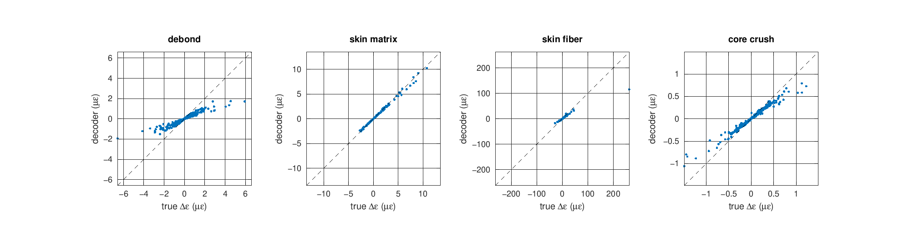
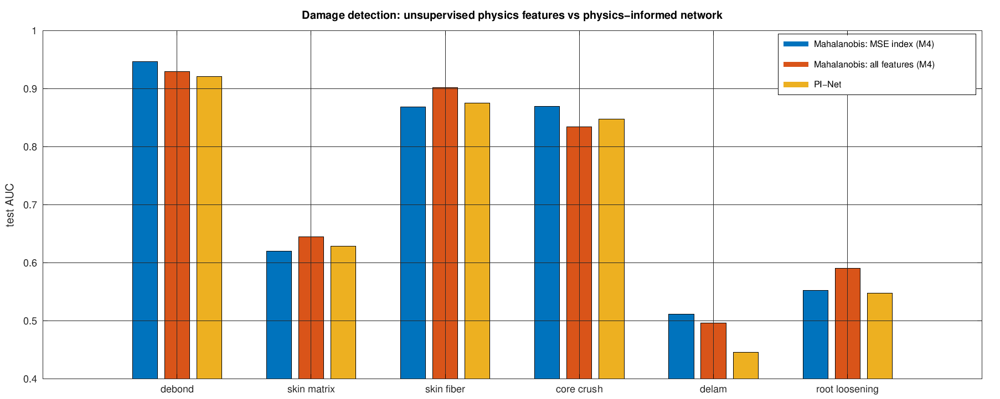
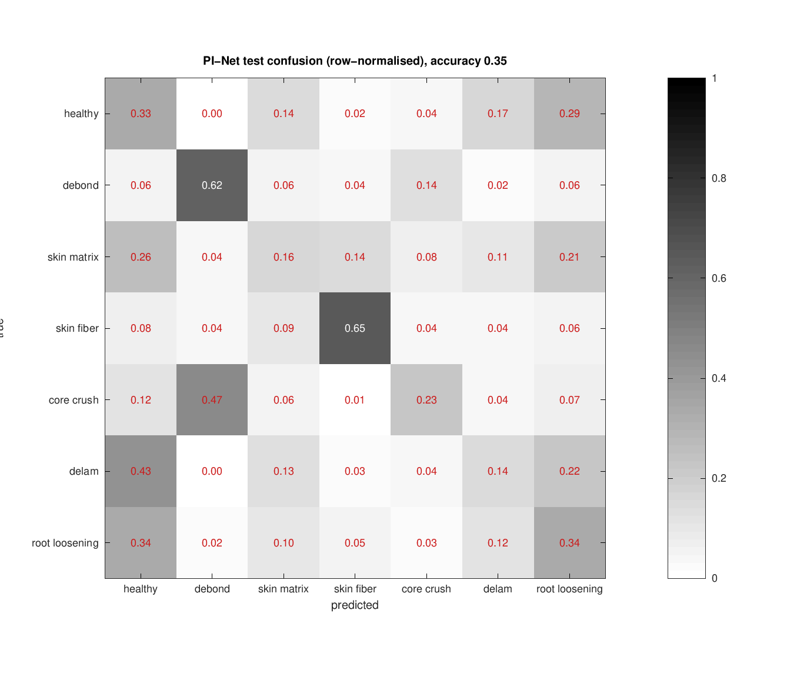
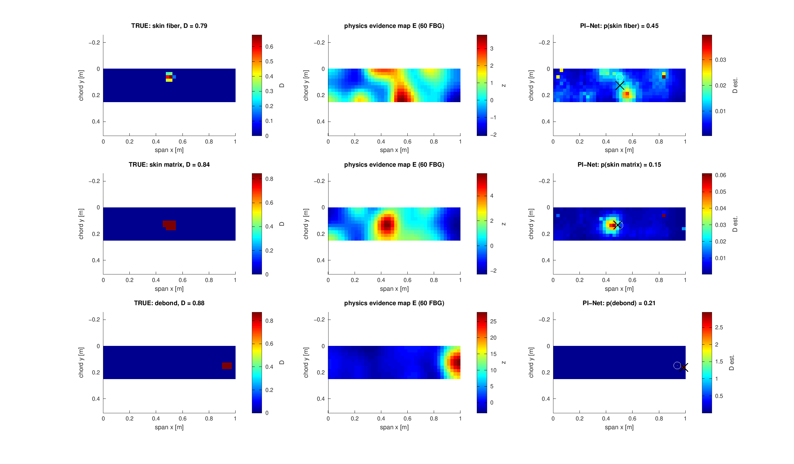
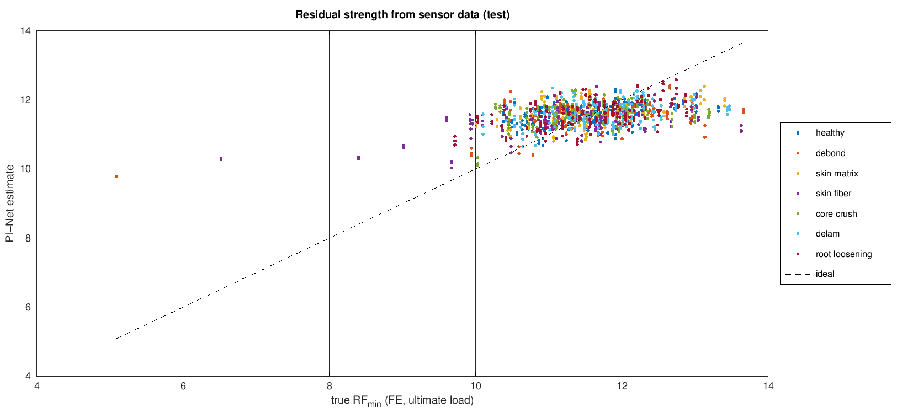
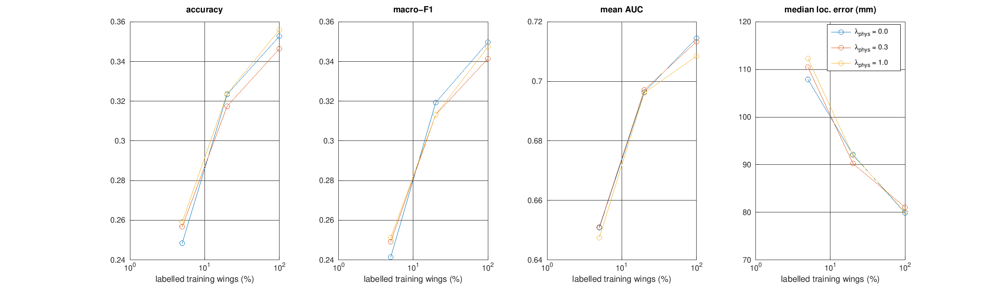
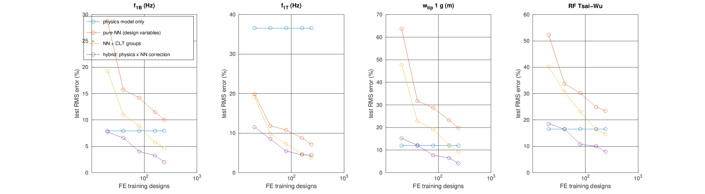
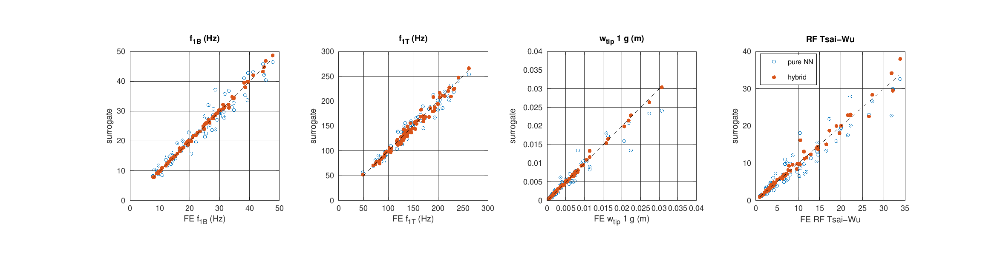
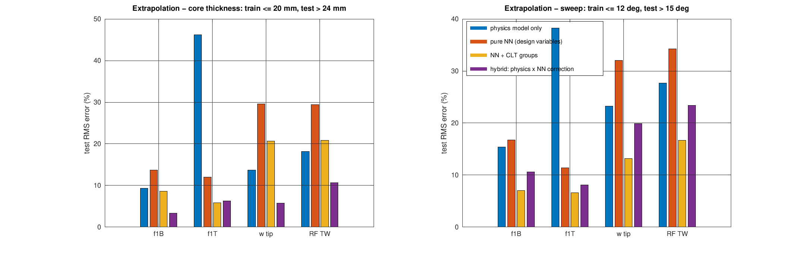

# Milestone 5 — Physics-Informed AI Model Development (Step 6)

**Deliverable of this step:** *"Trained physics-informed AI models"*
**Script:** `milestone5/run_milestone5.m` (log: `results/data/M5_summary.txt`; about 20 min in Octave, faster in MATLAB)
**Models:** `results/models/pinet_fbg.mat`, `pinet_dense.mat`, `surrogate_hybrid.mat`, `M5_results.mat`
**New code:** `src/pinn/` (PI-Net, physics decoder, evidence map, beam prior, hybrid surrogate), `src/ml/` (MLP, Adam, gradient check), `validation/val12_ai_components.m`

---

## 1. Purpose — and what "physics-informed" means here

Step 6 of the workflow asks for ML/DL models whose loss contains the governing equations and boundary conditions, so that predictions stay physically consistent. Milestone 5 builds **two** physics-informed AI models. Both are used later by the digital twin (Milestone 6).

| Model | Question it answers | Data |
|---|---|---|
| **PI-Net** (damage diagnosis) | *Is the wing damaged? What type, which face, where, how large, how much strength is left?* | SHM tier: 8 400 noisy sensor records (Milestone 4) |
| **Hybrid surrogate** (design / health-state model) | *What are f₁B, f₁T, tip deflection and strength of a wing with these design parameters?* in microseconds instead of 9 s of FE | Design tier: 400 FE wings (Milestone 3) |

Physics enters these models in **five** distinct ways. Each one is tested separately in the ablation studies:

| # | Mechanism | Where | Physics used |
|---|---|---|---|
| P1 | **Healthy-referenced inputs** | PI-Net input layer | Damage = deviation from the healthy population; EOV-correlated directions are whitened (Mahalanobis) |
| P2 | **Physics-consistency loss** (discrete PINN residual) | PI-Net loss | Discretised governing equations K u = F and K φ = λ M φ, through FE sensitivities |
| P3 | **Physics evidence prior** | PI-Net map head | Modal-strain-energy and strain-residual damage indices (Milestone 4) |
| P4 | **Reduced-order mechanics + learned model-form error** | Hybrid surrogate | Ritz beam on elastic root, CLT, Dunkerley, Tsai–Wu |
| P5 | **Dimensionless CLT groups** as inputs | Hybrid surrogate | Bending-twist coupling D₁₆, D₂₆, orthotropy, core shear flexibility |

**Why not a "classic" collocation PINN?** A classic PINN (Raissi et al. 2019) trains a network u(x; θ) so that the PDE residual vanishes at collocation points. It is a *PDE solver*. We already have an exact, validated FSDT solver (Milestone 2: 56/56 checks). The open problem is the **inverse** problem: from sparse, noisy sensors, infer the damage field. For the inverse problem, the most effective way to embed the governing equations is the **discrete** form, K(D) u = F. Its exact first-order sensitivity, computed by adjoint and eigenvalue-perturbation analysis, becomes a differentiable "physics decoder" inside the loss (P2). This keeps the full fidelity of the FE model, including the elastic root BC, the sandwich shear correction and the sensor positions. A collocation PINN would have to *re-learn* all of that.

---

## 2. Theory

### 2.1 Feed-forward networks (ANN / MLP)

A multilayer perceptron maps inputs x through layers

$$\mathbf a^{(0)}=\mathbf x,\qquad \mathbf a^{(l)}=\tanh\!\left(\mathbf a^{(l-1)}\mathbf W^{(l)}+\mathbf b^{(l)}\right),\quad l=1..L .$$

Output heads use the link function that matches each physical quantity:

| Quantity | Link | Range |
|---|---|---|
| Class probabilities | softmax $p_c=e^{z_c}/\sum_k e^{z_k}$ | simplex |
| Damaged face | sigmoid $\sigma(z)=1/(1+e^{-z})$ | (0, 1) |
| Damage map | softmax over the 400 elements | sums to 1 |
| Damage extent | softplus $s=\ln(1+e^{z})$ | ≥ 0 |
| Residual strength | linear | ℝ |

- **Initialisation (Glorot & Bengio 2010):** $W\sim U\!\left(-\sqrt{6/(n_{in}+n_{out})},\,+\sqrt{6/(n_{in}+n_{out})}\right)$. This keeps the activation variance constant through tanh layers.
- **Optimiser — Adam (Kingma & Ba 2015):**

$$m_t=\beta_1m_{t-1}+(1-\beta_1)g_t,\quad v_t=\beta_2v_{t-1}+(1-\beta_2)g_t^2,\quad \theta_t=\theta_{t-1}-\eta_t\frac{\hat m_t}{\sqrt{\hat v_t}+\epsilon}$$

  with bias corrections $\hat m=m/(1-\beta_1^t)$ and $\hat v=v/(1-\beta_2^t)$. The learning rate follows a cosine schedule from η₀ to η₀/20.
- **Regularisation:**
  - L2 weight decay;
  - early stopping on the **validation** objective, with the best parameters kept;
  - **Gaussian input-noise augmentation** (σ = 0.6 in whitened units). The inputs *are* noisy measurements. Training with input noise is equivalent to Tikhonov regularisation of the input–output Jacobian (Bishop 1995), so the network cannot rely on exact feature values.

### 2.2 Back-propagation (hand-derived, no toolbox)

All gradients are derived and coded by hand. The key identities are:

| Block | Gradient |
|---|---|
| softmax + cross-entropy | $\partial L/\partial z = p - y$ |
| softmax (general upstream g) | $\partial L/\partial z = q\odot(g - q^Tg)$ |
| sigmoid + BCE | $\partial L/\partial z = p - t$ |
| softplus | $ds/dz=\sigma(z)$ |
| tanh layer | $\delta^{(l)}=\left(\delta^{(l+1)}W^{(l+1)T}\right)\odot\left(1-a^{(l)2}\right)$, $\;\partial L/\partial W^{(l)}=a^{(l-1)T}\delta^{(l)}$ |

They are verified against central finite differences:

$$\varepsilon_{rel}=\max_i\frac{|g_i-\tilde g_i|}{|g_i|+|\tilde g_i|},\qquad \tilde g_i=\frac{L(\theta+h e_i)-L(\theta-h e_i)}{2h},\; h=10^{-6}.$$

Correct code gives about 10⁻⁷. A single wrong term gives about 10⁻¹. This is validation check V12 in `run_all_validation`.

### 2.3 Healthy-referenced inputs (P1)

Damage is a **deviation from the healthy population**. That population is strongly correlated by environmental and operational variability (EOV): temperature, root fixity, mass and material scatter all move many features together (Milestone 3: EOV shifts frequencies 10–100× more than damage does). The 117 Milestone 4 features are therefore transformed with statistics of the **healthy training wings only**:

$$\mathbf z = \mathbf S_h^{-1/2}(\mathbf x-\boldsymbol\mu_h),\qquad \mathbf S_h \leftarrow 0.95\,\mathbf S_h+0.05\,\mathrm{diag}(\mathbf S_h)$$

(symmetric inverse square root from the eigen-decomposition). Then $\|\mathbf z\|^2$ *is* the Mahalanobis novelty index of Milestone 4.

Six family indices $\ln(1+D^2_g/n_g)$ are appended, one each for frequency, ratio, MAC, ULS, strain and MSE index. Temperature is excluded because it is EOV, not damage. This gives 123 inputs.

The network therefore starts from the optimal *unsupervised* detector. It only has to learn what statistics cannot: which **pattern** of deviations belongs to which damage type, where and how large.

### 2.4 PI-Net — architecture and multi-task loss

```
 123 inputs ─► tanh(64) ─► tanh(64) ─► h ─┬─► softmax(7)      p_c   class: healthy, debond, matrix, fibre, crush, delam, root
                                          ├─► sigmoid(1)      p_top damaged face
                                          ├─► softmax(400)    q_e   damage map   (+ a·E physics evidence prior, P3)
                                          ├─► softplus(1)     s     extent  Σ D_e / 5
                                          └─► linear(1)       rf    residual strength RF_min (standardised)
 decoder (P2):  d̂ = 5 s q  ──►  x̂ = Σ_t π_t J_t d̂ + π_root J_root 5s   ──►  compare with the measured Δx
```

**Supervised losses** (only on labelled wings):

$$L_{cls}=-\tfrac1N\textstyle\sum\ln p_{y},\quad L_{face}=\mathrm{BCE}(p_{top},t),\quad L_{map}=-\tfrac1N\textstyle\sum_e q^*_e\ln q_e,\quad L_{loc}=\tfrac{1}{N\ell^2}\textstyle\sum\|\sum_e q_e\mathbf x_e-\mathbf x^*\|^2,$$
$$L_{ext}=\tfrac1N\textstyle\sum(s-s^*)^2,\quad L_{rf}=\tfrac1N\textstyle\sum(rf-rf^*)^2$$

- q* = D/ΣD is the true (normalised) damage map, and ℓ = 0.1 m.
- Face labels exist only for skin and delamination damage; map and location labels only for localisable classes.
- The total loss is $L=\sum_k w_kL_k+\lambda_{phys}L_{phys}+\lambda_2\|W\|^2$, with $w$ = (1, 0.3, 0.3, 1, 0.3, 0.3), λ_phys = 0.3 and λ₂ = 10⁻².

### 2.5 The physics decoder and the physics-consistency loss (P2)

For every damage type t and element e, the first-order change of the measurable features per unit damage severity is computed **from the discretised governing equations** of the healthy reference wing:

**Natural frequencies — eigenvalue perturbation** (K φ = λ M φ, φᵀMφ = 1; damage changes only K):

$$\frac{\partial\lambda_k}{\partial D_e}=\boldsymbol\phi_k^T\frac{\partial\mathbf K_e}{\partial D}\boldsymbol\phi_k,\qquad \frac{\partial f_k}{f_k}=\frac{1}{2}\frac{\partial\lambda_k}{\lambda_k},\qquad \Delta\!\left(\frac{f_k}{f_1}\right)=\frac{f_k}{f_1}\left(\frac{\partial f_k}{f_k}-\frac{\partial f_1}{f_1}\right)$$

**Static tip-test strains — direct (adjoint) differentiation of K u = F:**

$$\frac{\partial\mathbf u}{\partial D_e}=-\mathbf K^{-1}\frac{\partial\mathbf K_e}{\partial D}\mathbf u,\qquad \Delta\varepsilon_s=\left(\mathbf B_m\mp\tfrac h2\mathbf B_b\right)_s\Delta\mathbf u$$

at all 60 FBGs (bottom −, top +). Then the **same** global-scale removal as the Milestone 4 feature:

$$\Delta\mathbf x=\frac{1}{\max|\varepsilon_0|}\left(\mathbf I-\frac{\varepsilon_0\varepsilon_0^T}{\varepsilon_0^T\varepsilon_0}\right)\Delta\varepsilon .$$

∂K_e/∂D is a forward difference of the *element* stiffness, using the damage module's own degradation rules. The decoder therefore knows exactly what each damage type does:

- a debond softens core shear;
- matrix cracks reduce E₂ and G₁₂ of one face;
- fibre breakage reduces E₁ of one face;
- crushing reduces core moduli;
- delamination reduces interlaminar shear coupling;
- root loosening reduces the root springs, including the elastic-root **boundary condition**.

Stacking all elements gives J_t (64 × 400) for 8 types, plus J_root.

**Physics-consistency loss.** The network's diagnosis is turned into a predicted damage field $\hat d_e=5\,s\,q_e$ and pushed through the decoder, with the type probabilities $\pi_t$ built from p_c and p_top:

$$\hat{\mathbf x}=\sum_{t}\pi_t\,\mathbf J_t\hat{\mathbf d}+\pi_{root}\,\mathbf J_{root}\,5s,\qquad L_{phys}=\frac{1}{N n_f}\sum_n\left\|\frac{\hat{\mathbf x}_n-\Delta\mathbf x_n}{\boldsymbol\sigma}\right\|^2 .$$

In words: **the damage the network claims to see must, through the governing equations, reproduce what the sensors measured.** This is the discrete analogue of a PINN residual. It has two important properties:

1. **It needs no labels.** L_phys is evaluated on *all* wings, so unlabelled wings (the normal case in service) still train the network (semi-supervised learning).
2. **It couples the heads physically.** Class, face, map and extent must be mutually consistent, because only a consistent combination reproduces the measurement.

### 2.6 Physics evidence-map prior (P3)

The map head computes

$$q_e=\mathrm{softmax}_e\!\left(\mathbf W\mathbf h+\mathbf b+a\,E_e\right),$$

- E is the Milestone 4 physics damage-evidence map, healthy-z-scored:
  - **FBG variant:** the MSE index plus the |strain residual| of both skins, at 30 grating positions, spread to elements with a Gaussian kernel (ℓ = 60 mm);
  - **dense variant:** the full-field z-map, e.g. from DIC.
- a is a learnable gain.

In Bayesian terms, $\ln q_e = \ln(\text{physics evidence}) + \text{learned correction} + \text{const}$. The network *refines* a physics-based localisation instead of learning the geometry of the wing from 1 960 examples (residual or prior learning).

### 2.7 Hybrid physics-AI surrogate (P4, P5)

**Reduced-order mechanics** (`beam_prior.m`, about 10 ms per design). The plate wing is condensed into a tapered cantilever on an elastic root:

- **Section properties (CLT):**
  - $EI(x)=c(x)/d_{11}$, with d = A⁻¹ of the full ABD matrix (wide-beam, free anticlastic curvature);
  - $kGA=c\,A_{s,11}$ (energy-equivalent k of Milestone 2);
  - $GJ=4D_{66}c$;
  - $m=I_0c$;
  - root springs $K_\theta=k^*D_{11}c_r/L$ (identical to the FE model).
- **f₁B — Rayleigh–Ritz.** Use $w=\sum_{j=1}^{6}a_j(x/L)^j$ and solve $\mathbf K\mathbf a=\omega^2\mathbf M\mathbf a$ with

$$K_{ij}=\int_0^L EI\,\phi_i''\phi_j''dx+K_\theta\phi_i'(0)\phi_j'(0),\qquad M_{ij}=\int_0^L m\,\phi_i\phi_j\,dx .$$

  The j = 1 term is the rigid rotation permitted by the root spring. Core shear is added with **Dunkerley's rule**, $f^{-2}=f_b^{-2}+f_s^{-2}$, where $f_s=\frac{1}{4L}\sqrt{kGA/m}$.
- **f₁T:** uniform torsion $\frac{1}{4L}\sqrt{GJ/I_p}$, in series with the root torsion spring (Dunkerley).
- **Tip deflection:** Ritz statics under the net 1 g load of the FE model (Schrenk lift − weight), plus the shear deflection $\int V/kGA\,dx$.
- **RF (Tsai–Wu):** ultimate bending moment at x_off; ply strains $\varepsilon=\varepsilon^0+z\kappa$ from the ABD inverse; then Tsai–Wu strength ratio of every face ply (first-ply failure).

The model **deliberately ignores** sweep (bending-torsion coupling), bend-twist coupling D₁₆/D₂₆, 2-D load diffusion at the root, chordwise bending and the true pressure distribution. That missing physics is the *model-form error*.

**Discrepancy learning** (Kennedy & O'Hagan 2001):

$$\ln y_{FE}(\mathbf x)=\ln y_{phys}(\mathbf x)+\delta_{NN}\big(\mathbf x,\;\boldsymbol\pi_{CLT}(\mathbf x),\;\ln y_{phys}(\mathbf x)\big)$$

The network learns only the *correction*. With no data the model falls back to physics. The inputs are:

- the 17 encoded design variables. Ply angles enter as (cos 2θ, sin 2θ), because a 0° and a 180° ply are the same ply.
- **six dimensionless CLT groups π_CLT (P5):** ln D₂₂/D₁₁, ln D₆₆/D₁₁, D₁₂/D₁₁, D₁₆/√(D₁₁D₆₆), D₂₆/√(D₂₂D₆₆) and ln D₁₁/(kGA L²). These are the similarity parameters of anisotropic plate mechanics. Variables with physical meaning generalise far better than raw angles.

Three alternatives are compared, all with identical networks, training and validation-based L2 selection:

- the pure network;
- the network plus CLT groups;
- the hybrid.

---

## 3. Verification of the building blocks

### 3.1 Gradients and reduced-order model (V12, part of `run_all_validation`)

| Check | Result | Tolerance | Status |
|---|---|---|---|
| PI-Net gradient, all 7 loss terms incl. physics decoder and evidence gain | max rel. error 2.2 × 10⁻⁷ | 10⁻⁵ | PASS |
| Surrogate MLP gradient | 3.6 × 10⁻⁷ | 10⁻⁵ | PASS |
| Beam/CLT prior f₁B vs FE (baseline wing) | 30.61 vs 30.88 Hz (0.9 %) | 5 % | PASS |
| Beam/CLT prior 1 g tip deflection vs FE | 1.174 vs 1.157 mm (1.4 %) | 5 % | PASS |

The validation suite now has **60 required checks, and all pass**.

### 3.2 Physics decoder vs exact nonlinear twins

The decoder is a *linearisation*, so it is checked against the noise-free "twin" pairs of Milestone 3 (the same wing simulated with and without damage, 60 per class). The predicted FBG strain change $\mathbf J_t\mathbf D$ is compared with the exact change:

| Damage | cosine(predicted, true) median (p10) | amplitude ratio | true signal ‖Δε‖ |
|---|---|---|---|
| Core debond | 0.999 (0.993) | 0.75 | 1.18 µε |
| Skin matrix cracks | 0.999 (0.963) | 0.96 | 0.86 µε |
| Skin fibre breakage | 0.999 (0.985) | 0.85 | 2.57 µε |
| Core crush | 0.996 (0.982) | 0.86 | 0.43 µε |
| Delamination | — | — | < 0.001 µε, invisible to static strain |



**Interpretation:**

- The decoder reproduces the **shape** of the strain change almost exactly (cosine ≈ 0.999).
- It under-predicts the **amplitude** of large damage by 4–25 %. Stiffness loss is nonlinear in D: a strongly softened element sheds load to its neighbours.
- The most important number is the last column. The whole damage signature in the 60-FBG tip test is **0.4–2.6 µε**. The FBG noise is 1 µε per grating, plus 0.5 % gain and 1 % load error. The physics is right, but the information available to *any* model, physics-informed or not, is close to the noise floor. Every result below must be read against this.

---

## 4. PI-Net results (untouched test set: 420 wings, 1 260 records)

Model: 123 → 64 → 64 → heads, 38 747 parameters. It was trained in 36 s (63 epochs, best validation at epoch 23), with λ_phys = 0.3 and the FBG evidence prior. All choices (inputs, width, L2, noise level, λ, prior) were made on the **validation** set; the test set was used once.

### 4.1 Detection (healthy vs each damage type)

| Method | debond | skin matrix | skin fibre | core crush | delam | root loosening |
|---|---|---|---|---|---|---|
| AUC — Mahalanobis, MSE index (M4) | **0.95** | 0.62 | 0.87 | **0.87** | 0.51 | 0.55 |
| AUC — Mahalanobis, all features (M4) | 0.93 | **0.65** | **0.90** | 0.83 | 0.50 | **0.59** |
| AUC — **PI-Net** (1 − p_healthy) | 0.92 | 0.63 | 0.88 | 0.85 | 0.45 | 0.55 |
| Detection rate @ 1 % FA — MSE index (M4) | 81 % | 18 % | 50 % | 62 % | 3 % | 16 % |
| Detection rate @ 1 % FA — **PI-Net** | **86 %** | **27 %** | **73 %** | **63 %** | 3 % | **21 %** |



**Interpretation:**

- **Overall ranking (AUC):** PI-Net equals the best unsupervised detector, within ±0.03.
- **Detection at an operational false-alarm level:** PI-Net detects clearly more. Fibre-break detection rises from 50 % to **73 %**, matrix cracks from 18 % to 27 %, and debonds from 81 % to 86 %. The network combines the families selectively, while the "all features" Mahalanobis distance dilutes them (Milestone 4, finding 4).
- **Measured false-alarm rate:** 3.3 % on the test set, against the 1 % target set on validation. With 180 healthy validation records, the 99th percentile is estimated from only about 2 exceedances. Milestone 6 will calibrate the threshold on a larger healthy baseline using extreme-value statistics.
- **Delamination** stays at chance level, consistent with the < 0.001 µε signal above.

### 4.2 Damage-type diagnosis (7 classes)

**Accuracy 0.355, macro-F1 0.349** (chance 0.143). Per-class F1: fibre 0.67, debond 0.57, root loosening 0.30, core crush 0.29, healthy 0.26, delam 0.18, matrix 0.18.



The confusion matrix has a clear **physical structure**:

- **Core crush → debond (44 %).** Both degrade the core and produce nearly the same modal-strain-energy pattern, which is a genuine physical ambiguity.
- **Healthy ↔ delamination ↔ root loosening ↔ matrix** form one confusion block. These are the four "invisible" states: their signals are below the EOV scatter, so the network spreads probability among them.
- **Fibre breakage and debonding** are the two classes with strong, distinctive signatures, and they are recognised (67 % and 59 % recall).

This is the honest information limit of a 60-FBG + 12-accelerometer network under realistic EOV. It is *not* a training failure: the same limits appeared in the purely physical analysis of Milestones 3–4.

### 4.3 Localisation (significant damage: D > 0.5, radius > 30 mm)

| Class | M4 rule, 60 FBG | **PI-Net, 60 FBG** | M4 rule, dense | **PI-Net, dense** |
|---|---|---|---|---|
| Debond | 92 mm | 84 mm | 59 mm | 64 mm |
| Skin matrix | **67 mm** | 90 mm | **21 mm** | 58 mm |
| Skin fibre | **24 mm** | 37 mm | 6 mm | 8 mm (98 % < 50 mm) |
| Core crush | 161 mm | **99 mm** | 177 mm | **94 mm** |



**Interpretation:**

- **Core crush improves the most** (161 → 99 mm with FBGs, 177 → 94 mm dense). The rule-based method fails because crush leaves almost no surface-strain trace. The network learns to combine the weak modal evidence with the strain map, so the multivariate model adds information here.
- **For skin damage the simple M4 rule is still sharper.** Its "top-k sensors" readout is a near-optimal estimator when the evidence is a sharp peak at the sensor spacing (100 × 75 mm). The network reports the centroid of a *probability map*, which is smoother.
- This is why both are kept. The digital twin (M6) uses the PI-Net map as a **posterior** and the rule as a point estimate.
- The damage-map panels show what the network outputs. For the fibre break (top row), the evidence map is diffuse. The network's map concentrates near the true site, but with only p = 0.47 confidence. That uncertainty is honest.

### 4.4 Quantification and residual strength

| Quantity | Result |
|---|---|
| Damaged face (skin damage) | 64 % correct |
| Damage extent ΣD | Spearman ρ = 0.26, R² ≈ 0 |
| Residual strength RF_min | RMSE 0.76 (R² 0.22); clearly weakened wings: RMSE 1.87 |



**Honest conclusion:** *direct* regression of extent and strength from noisy global features does **not** work well. This is not a modelling detail. Strength is governed by the **local** stress concentration at the damage, while the sensors see the **global** stiffness change, which is 1–3 µε. Two wings with the same sensor signature can have very different RF.

This result decides the architecture of Milestone 6. The twin will **not** regress RF from features. It will:

1. use PI-Net to estimate type, location and the damage-map posterior;
2. insert that damage into the **FE model** (model updating);
3. compute RF with Tsai–Wu and Hashin, i.e. physics.

This is the standard "diagnosis → model update → prognosis" chain of a structural digital twin (Farrar & Worden 2013), and it is far more reliable for strength.

### 4.5 Physics consistency

Mean squared residual between the decoded and the measured feature changes on the test set, in units of the healthy σ:

| Prediction | Residual |
|---|---|
| "No damage" | 2.99 |
| PI-Net with λ_phys = 0 | 1.81 |
| **PI-Net with λ_phys = 0.3** | **1.58** |
| PI-Net with λ_phys = 1 | 1.57 |

With the physics loss, the network's diagnoses explain **47 %** of the measured feature change through the governing equations, against 39 % without it. Its outputs are *physically consistent* explanations of the data, not just labels.

---

## 5. Ablation studies — what each physics ingredient contributes

### 5.1 Healthy-referenced inputs (P1) — the largest single gain

Development history, **validation** set, identical network (64-64, L2 10⁻², input noise 0.6):

| Inputs | Accuracy | AUC debond / matrix / fibre / crush |
|---|---|---|
| Standardised features (z-score over all training data) | 0.247 | 0.83 / 0.66 / 0.69 / 0.78 |
| **Healthy-whitened + family novelty indices** | **0.350** | **0.93 / 0.74 / 0.88 / 0.82** |

The first networks were **worse than the unsupervised Mahalanobis detector**. The reason: with about 2 000 training wings, a network cannot discover the 117 × 117 EOV covariance structure by itself. Giving it the healthy reference explicitly is a physics/statistics prior, and it raised accuracy by 40 % (relative).

### 5.2 Evidence-map prior (P3), test set

| Variant | Accuracy | Median localisation error, debond / matrix / fibre / crush | Hit < 50 mm |
|---|---|---|---|
| No prior | 0.347 | 73 / 129 / 102 / 89 mm | 18 % |
| FBG evidence prior | 0.355 | 84 / 90 / **37** / 99 mm | 32 % |
| Dense evidence prior | 0.359 | 64 / **58** / **8** / 94 mm | **51 %** |

- The prior is what makes **skin-damage localisation** work: the fibre-break error drops from 102 to 37 mm.
- The learned gain a ≈ 0.5 shows that the network trusts the physics map but also corrects it.
- The prior does not change the classification.

### 5.3 Physics loss (P2) × labelled fraction — semi-supervised learning

Each cell is the mean of 2 seeds on the test set. Unlabelled training wings contribute only through L_phys.

| Labelled wings | λ_phys | Accuracy | Macro-F1 | Mean AUC | Physics residual |
|---|---|---|---|---|---|
| 5 % | 0 | 0.248 | 0.241 | 0.651 | 2.45 |
| 5 % | 0.3 | 0.257 | 0.249 | 0.651 | 2.13 |
| 5 % | 1.0 | **0.259** | **0.251** | 0.647 | **2.00** |
| 20 % | 0 | 0.323 | 0.319 | 0.696 | 2.39 |
| 20 % | 0.3 | 0.317 | 0.313 | 0.697 | 1.80 |
| 20 % | 1.0 | 0.324 | 0.313 | 0.696 | 1.73 |
| 100 % | 0 | 0.353 | 0.350 | 0.714 | 1.81 |
| 100 % | 0.3 | 0.346 | 0.341 | 0.713 | 1.58 |
| 100 % | 1.0 | 0.356 | 0.347 | 0.708 | 1.57 |



**Honest reading:**

1. The physics loss **always** makes predictions more physically consistent: the residual falls by 13–28 %.
2. It gives a **small accuracy benefit only in the scarce-label regime** (5 % labels: +1 point accuracy and macro-F1). With 20–100 % labels, the effect (±0.01) is inside the seed-to-seed scatter.
3. The reason is §3.2. The physics loss can only transfer information that is *in* the measurement. With a damage signature of 0.4–2.6 µε against about 1 µε noise, unlabelled data contain little extra damage information. The literature reports large PINN gains in settings with rich, low-noise data (full-field, many sensors). Our study quantifies why such gains do not automatically carry over to a sparse, realistic SHM network.

This is a **negative result**, reported because it is true and useful. The physics loss is retained (λ = 0.3) for consistency and the low-label benefit, not because it raises accuracy.

---

## 6. Hybrid physics-AI surrogate (design tier)

### 6.1 Reduced-order model alone

Over 400 random designs (ply angles ±90°, ply 0.10–0.20 mm, core 8–30 mm, foam grade 0.5–2, 3 face materials, taper 0.5–1, sweep 0–20°, root fixity k* 200–5 000):

| Output | Median FE / model | corr(log) | RMS error |
|---|---|---|---|
| f₁B | 1.004 | 0.981 | 7.9 % |
| f₁T | 0.750 | 0.904 | 36.6 % |
| w_tip (1 g) | 0.984 | 0.991 | 12.0 % |
| RF Tsai–Wu | 0.964 | 0.983 | 16.6 % |

The 10 ms beam/CLT model already captures most of the physics. Torsion is the weakest output (−25 % bias): the Kirchhoff plate estimate GJ = 4D₆₆c ignores core shear in torsion.

### 6.2 Learning curves — test RMS error vs number of FE training designs

80 unseen test designs, 3 random splits:

| n FE designs | Physics only | Pure NN | NN + CLT groups | **Hybrid** |
|---|---|---|---|---|
| 20 | 7.9 / 36.6 / 12.0 / 16.6 | 28.7 / 19.9 / 63.7 / 52.3 | 19.3 / 19.2 / 47.8 / 40.2 | **7.7 / 11.5 / 15.2 / 18.6** |
| 40 | 〃 | 15.7 / 11.9 / 31.8 / 33.7 | 11.0 / 9.8 / 22.8 / 30.6 | **6.6 / 8.5 / 12.1 / 16.5** |
| 80 | 〃 | 14.2 / 10.8 / 28.7 / 30.2 | 8.8 / 7.3 / 19.2 / 23.1 | **4.0 / 5.4 / 7.7 / 10.8** |
| 160 | 〃 | 11.5 / 8.8 / 23.2 / 24.9 | 5.7 / 4.7 / 12.1 / 16.4 | **3.2 / 4.5 / 6.6 / 10.0** |
| 240 | 〃 | 10.0 / 7.1 / 19.8 / 23.5 | 4.7 / **3.9** / 9.2 / 14.6 | **2.0** / 4.5 / **4.1** / **8.0** |

(Values are % for f₁B / f₁T / w_tip / RF.)




**Interpretation:**

- **Data efficiency.** The hybrid with **40** FE runs is as accurate as, or better than, the pure network with **240** runs, which is **6× fewer** expensive simulations. At 240 designs, its tip-deflection error is 5× smaller (4.1 % vs 19.8 %).
- **Physically meaningful inputs matter by themselves.** Replacing raw angles by the dimensionless CLT groups (NN + CLT) halves the pure network's error. The bend-twist coupling terms D₁₆ and D₂₆ are exactly what the beam model misses.
- **Small-data safety.** With 20 designs, the pure network is useless (64 % tip-deflection error). The hybrid is never much worse than the physics model, because its correction starts at zero.

### 6.3 Extrapolation — designs outside the training range

| Test | Physics only | Pure NN | NN + CLT | **Hybrid** |
|---|---|---|---|---|
| Core: train ≤ 20 mm, test > 24 mm | 9.3 / 46.3 / 13.7 / 18.1 | 13.7 / 12.0 / 29.6 / 29.4 | 8.6 / **5.9** / 20.6 / 20.8 | **3.3** / 6.2 / **5.8** / **10.7** |
| Sweep: train ≤ 12°, test > 15° | 15.4 / 38.3 / 23.2 / 27.7 | 16.7 / 11.4 / 32.1 / 34.2 | **7.0 / 6.6 / 13.2 / 16.7** | 10.6 / 8.1 / 19.9 / 23.4 |



This is the most instructive result of the milestone:

- **Core-thickness extrapolation: the hybrid wins clearly.** Error is 3–11 %, versus 12–30 % for the pure network. Core thickness is a variable the *physics model handles correctly* (sandwich bending ∝ h², Dunkerley shear). The physics carries the prediction outside the data, and the network only corrects a smooth residual.
- **Sweep extrapolation: the hybrid loses to NN + CLT.** Sweep is precisely what the beam model **ignores**. Its error grows with sweep (15–38 %), so the hybrid must extrapolate a *growing* model-form error, and a network cannot extrapolate a trend it has not seen.

> **Design rule for physics-AI hybrids:** a hybrid extrapolates well in the directions its physics model represents, and no better than its physics model in directions it ignores. The physics core must contain the mechanisms along which you intend to extrapolate. For a swept-wing study, add bending-torsion coupling to `beam_prior`.

This rule will guide Milestone 6: the twin's own physics core is the full FE model, which contains *all* mechanisms.

---

## 7. How Milestone 5 maps to the workflow's Step 6

| Step-6 requirement | Delivered |
|---|---|
| Train ML/DL models (PINN, ANN, GNN) | ANN: PI-Net multi-task network (7 + 1 + 400 + 1 + 1 outputs) and MLP surrogates, all from scratch with verified gradients. PINN principle: discrete governing-equation residual in the loss (§2.5). Graph structure: the 400-element map head works on the FE mesh with a mesh-based evidence prior. A message-passing GNN was not needed: the decoder J already encodes the mesh connectivity *exactly* through K⁻¹. |
| Embed governing equations / BCs in the loss | L_phys uses eigenvalue perturbation of Kφ = λMφ and adjoint statics of Ku = F. It includes the elastic-root BC (J_root) and the sensor operator. |
| Enforce physical consistency | Physics residual reduced by 13–28 %; consistent class/face/map/extent; the hybrid falls back to physics; physical output links (softplus extent ≥ 0, softmax map). |
| Validate the models | Leakage-free split by wing; test set used once; finite-difference gradient checks (V12); decoder vs nonlinear twins; ablations with 2–3 seeds. |

---

## 8. Summary

**Key results:**

- **Detection:** PI-Net raises the detection rate at an operational false-alarm level over the best Milestone 4 detector: fibre breaks 50 → **73 %**, matrix cracks 18 → **27 %**, debonds 81 → **86 %**.
- **Diagnosis:** 7-class accuracy 0.355 (chance 0.143). Fibre breaks and debonds are recognised; the four low-signal states form a physically explainable confusion block.
- **Localisation:** fibre breaks to 8 mm (full-field) and 37 mm (60 FBG). Core crush, which the rule-based method cannot localise, improves from 161 to 99 mm.
- **Hybrid surrogate:** 2–8 % error with 240 FE runs. It matches a pure network that needs 6× more data, and it extrapolates in core thickness with 3–11 % error versus 12–30 %.
- **Most useful physics ingredients (in order):**
  1. healthy-referenced inputs (+40 % accuracy);
  2. reduced-order mechanics with discrepancy learning;
  3. dimensionless CLT inputs;
  4. the evidence prior for localisation;
  5. the physics loss, which buys consistency and a small low-label benefit.

**Honest limits:**

- The static-strain damage signal (0.4–2.6 µε) is near the sensor noise. This bounds every model.
- Delamination is undetectable by this sensor network.
- Direct regression of strength from features is unreliable, so Milestone 6 computes strength by **FE model updating** instead.
- The hybrid surrogate inherits the blind spots of its physics core (sweep).
- Results vary by about ±0.01 between runs because of multithreaded floating-point summation, in Octave and MATLAB alike. The conclusions do not change.

**Next — Milestone 6 (Steps 7–10):**

- Assemble the digital twin: FE model, PI-Net diagnosis, Bayesian model updating of the damage, and virtual sensing (strain and RF at unmeasured locations).
- Damage quantification by model updating, then fatigue-driven prognostics and RUL.
- End-to-end validation on unseen damage scenarios.

---

## 9. References

1. Raissi, M., Perdikaris, P., Karniadakis, G.E., "Physics-informed neural networks: A deep learning framework for solving forward and inverse problems involving nonlinear PDEs," *J. Comput. Phys.* 378, 2019.
2. Karniadakis, G.E. et al., "Physics-informed machine learning," *Nat. Rev. Phys.* 3, 2021.
3. Kennedy, M.C., O'Hagan, A., "Bayesian calibration of computer models," *J. R. Stat. Soc. B* 63, 2001.
4. Willard, J., Jia, X., Xu, S., Steinbach, M., Kumar, V., "Integrating scientific knowledge with machine learning for engineering and environmental systems," *ACM Comput. Surv.* 55, 2022.
5. Kingma, D.P., Ba, J., "Adam: A method for stochastic optimization," *ICLR* 2015.
6. Glorot, X., Bengio, Y., "Understanding the difficulty of training deep feedforward neural networks," *AISTATS* 2010.
7. Bishop, C.M., "Training with noise is equivalent to Tikhonov regularization," *Neural Comput.* 7, 1995.
8. Fox, R.L., Kapoor, M.P., "Rates of change of eigenvalues and eigenvectors," *AIAA J.* 6, 1968.
9. Haftka, R.T., Gürdal, Z., *Elements of Structural Optimization*, Kluwer, 1992 (adjoint / direct sensitivity analysis).
10. Caruana, R., "Multitask learning," *Mach. Learn.* 28, 1997.
11. Worden, K., Manson, G., Fieller, N.R.J., "Damage detection using outlier analysis," *J. Sound Vib.* 229, 2000.
12. Farrar, C.R., Worden, K., *Structural Health Monitoring: A Machine Learning Perspective*, Wiley, 2013.
13. Jones, R.M., *Mechanics of Composite Materials*, 2nd ed., Taylor & Francis, 1999 (CLT, D₁₆/D₂₆ coupling).
14. Tsai, S.W., Wu, E.M., "A general theory of strength for anisotropic materials," *J. Compos. Mater.* 5, 1971.
15. Blevins, R.D., *Formulas for Natural Frequency and Mode Shape*, Van Nostrand, 1979 (Rayleigh–Ritz, Dunkerley).
